# Part F. Working Sprint 1 and verification

Release under assessment: tag `{{RELEASE_TAG}}`, commit `{{RELEASE_COMMIT}}` on `main`.
Evidence below was produced from commit `{{EVIDENCE_COMMIT}}` (feature branch head, identical code to the release
unless stated in F.8).

## F.1 Setup summary

Full instructions are in `README.md`. Summary:

| Step | Command |
|---|---|
| Install | `npm install` (Node 22, npm workspaces `server` and `web`) |
| Database | PostgreSQL 16; role `app`, databases `cpms_dev`, `cpms_test`, `cpms_e2e` |
| Configure | `cp server/.env.example server/.env` and set `SESSION_SECRET` |
| Migrate and seed | `npm run db:migrate && npm run db:seed` |
| Run | `npm run dev` (web :5173, API :3000) or `npm run build && npm start` (:3000) |
| Unit + API tests | `npm test` |
| End-to-end tests | `npm run test:e2e` |

Seeded synthetic accounts: supervisors `sup1@cpms.test` (Team Alpha, Team Beta) and `sup2@cpms.test` (Team Gamma);
students `s1`/`s2` (Alpha), `s3`/`s4` (Beta), `s5`/`s6` (Gamma) `@cpms.test`. The demo password is printed by the
seed script; it is synthetic and used only locally.

## F.2 Program demonstrations

All screenshots: local release on `http://localhost:3100`, fresh `cpms_e2e` seed, Chromium.

### Scenario 1: normal journey and retrieval of the saved result (F-03, F-04, F-05; AC-06, AC-11, AC-17, AC-21)

Start: seeded data, Team Alpha has no "Sprint 1 release" milestone.
Steps: Sup1 creates the milestone; S1 submits title/description/link; S1 reloads the page (retrieval from DB);
Sup1 records feedback; S1 opens the milestone again.
Expected: each step is saved and visible after reload; S1 sees the feedback and the submission is locked.
Actual: as expected (screens below).

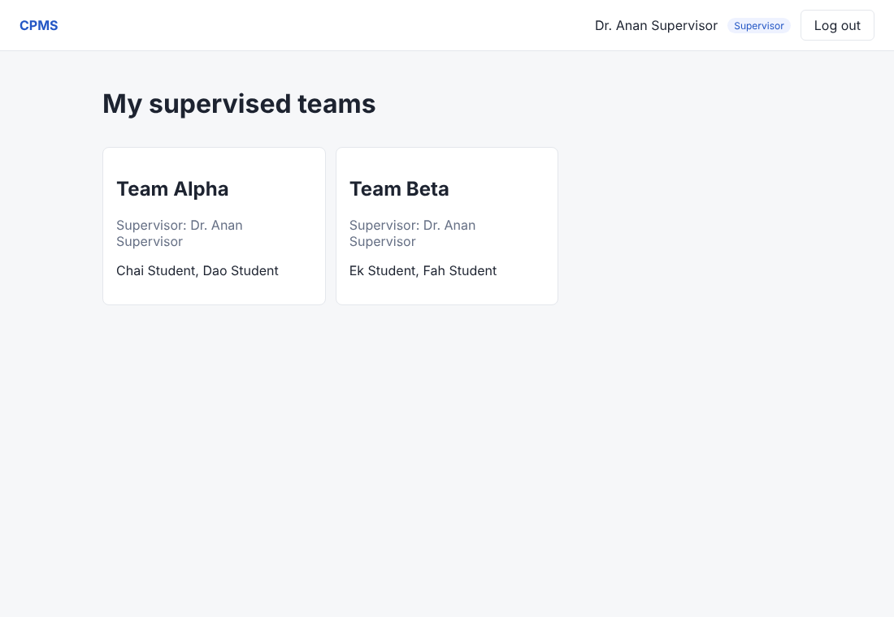

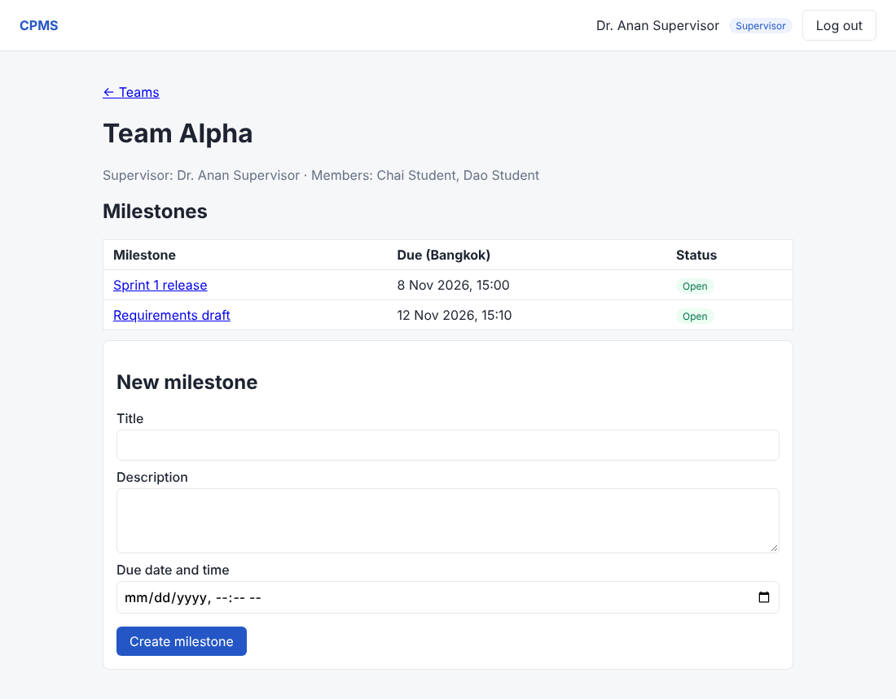

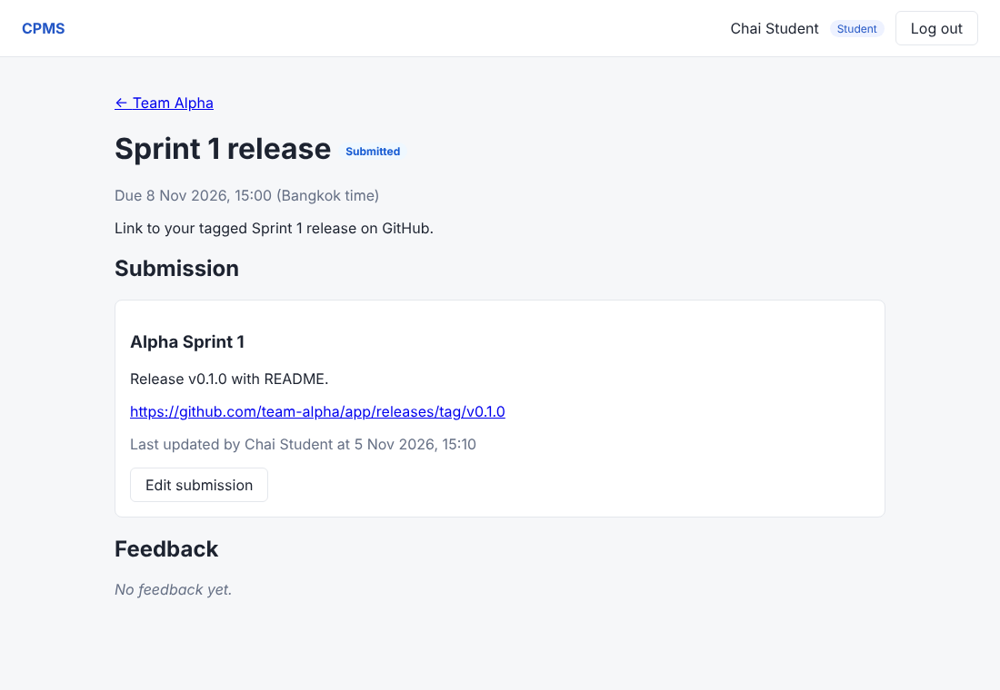

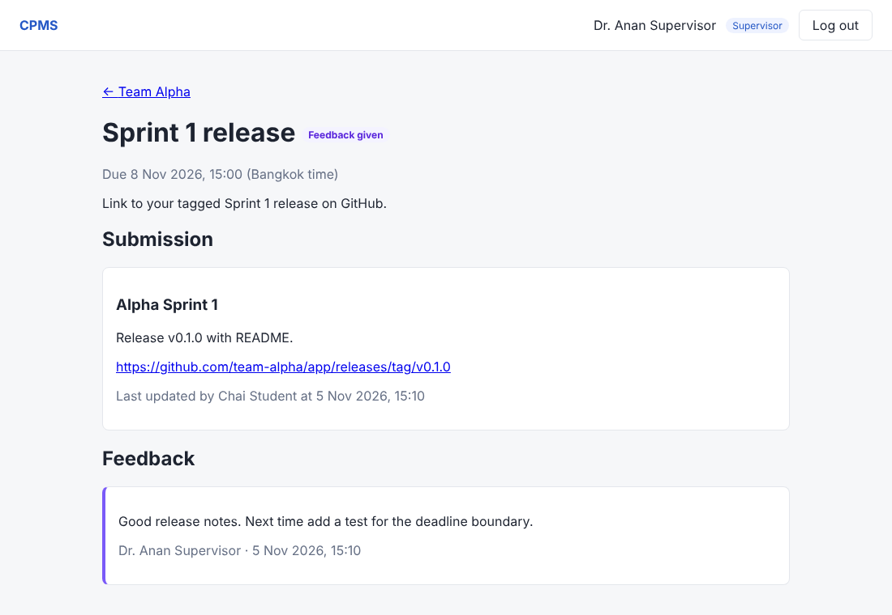

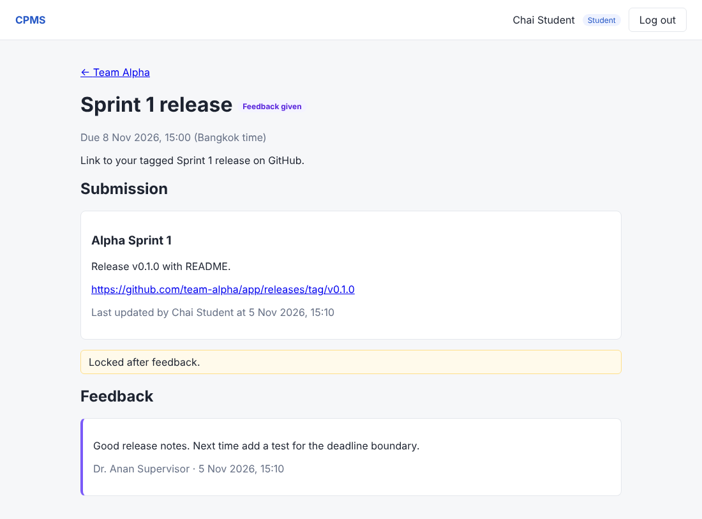

### Scenario 2: business-rule and boundary rejections (BR-04, BR-06, BR-07, BR-09; AC-07, AC-13, AC-14, AC-18)

Expected: past due date, invalid link, submitting after the deadline and editing after feedback are rejected.
Actual: as expected. UI rejections:

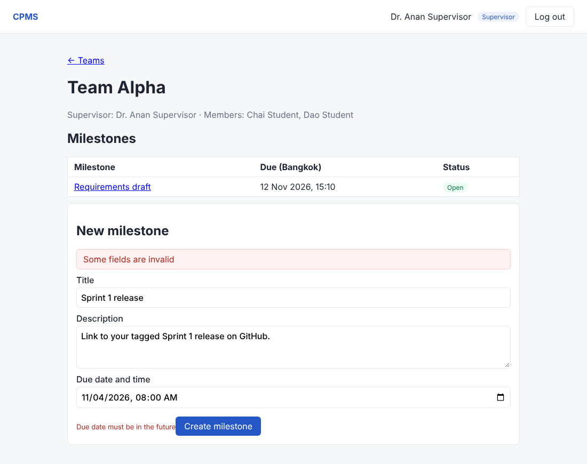

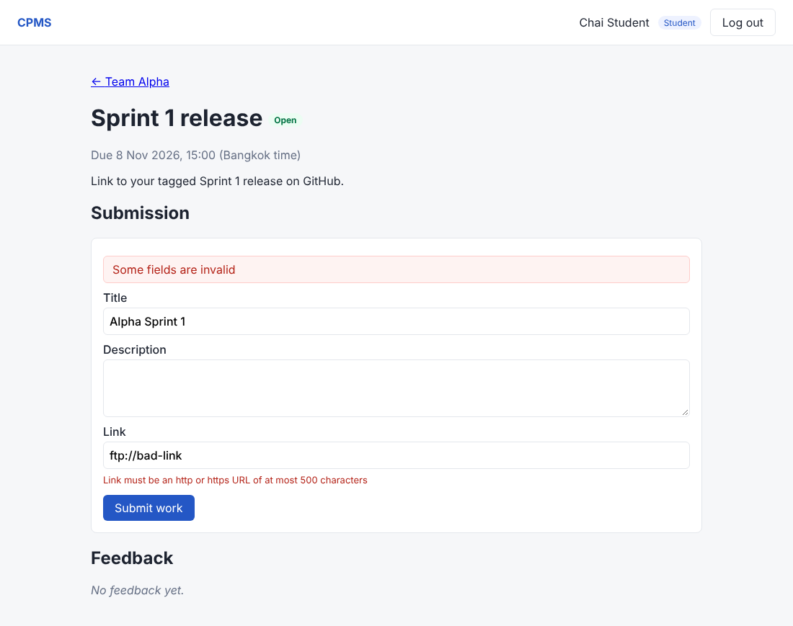

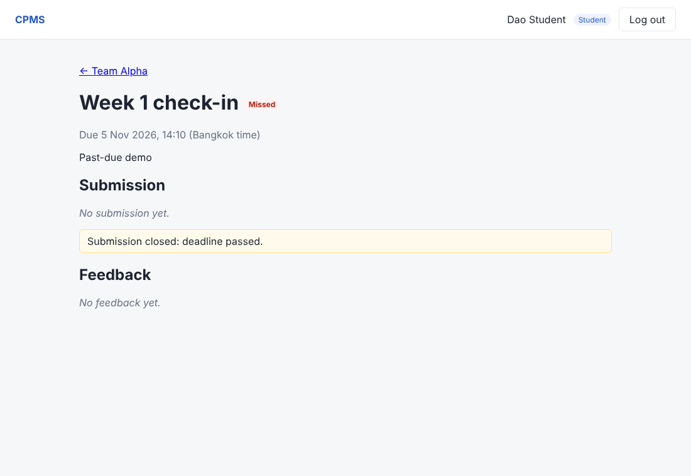

The same rules enforced by the backend, called directly (no UI), from `docs/evidence/api-demo.txt`:

```
POST /api/milestones/<past-due>/submission  (as S1)
HTTP/1.1 422 Unprocessable Entity
{"error":{"code":"DEADLINE_PASSED","message":"The milestone due date has passed"}}

PUT /api/milestones/<with feedback>/submission  (as S1)
HTTP/1.1 409 Conflict
{"error":{"code":"SUBMISSION_LOCKED","message":"The submission is locked after feedback"}}
```

### Scenario 3: login/logout, forbidden role and ownership (F-01, F-02; AC-02, AC-04, AC-09, AC-15, AC-22)

Expected: wrong password rejected; another team's milestone is not shown; a student cannot create milestones;
after logout the old session no longer works.
Actual: as expected.

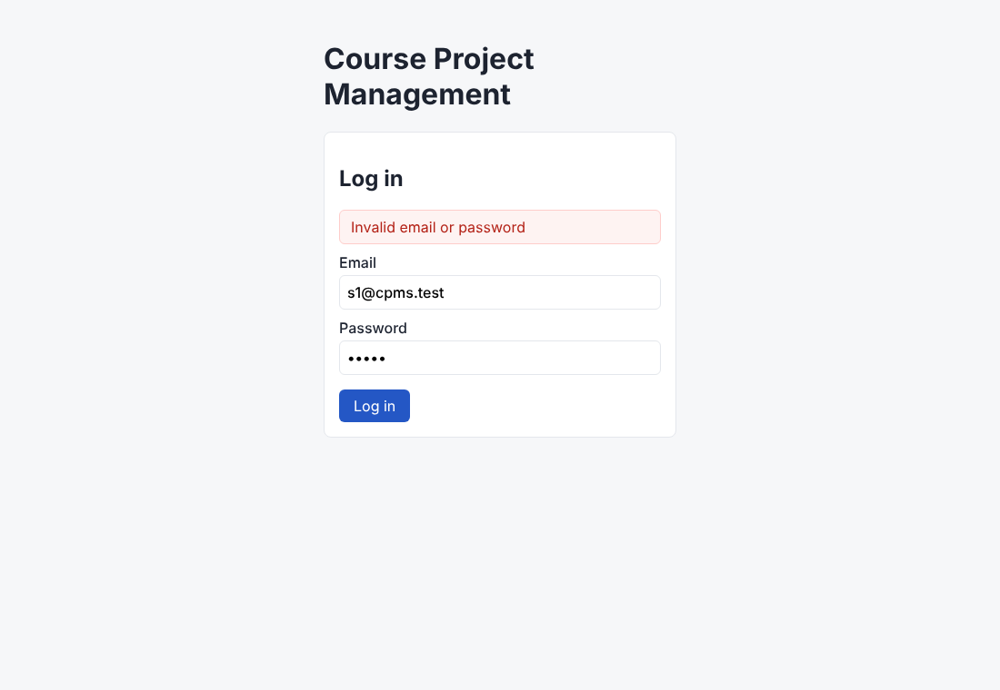

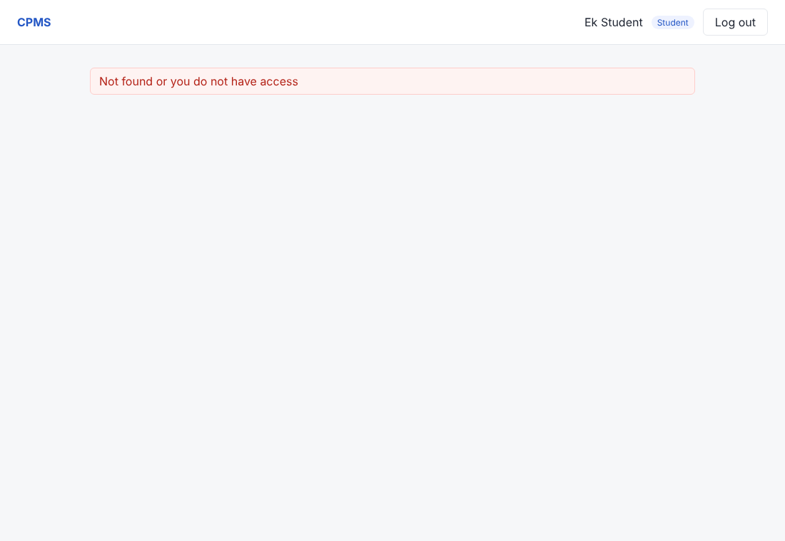

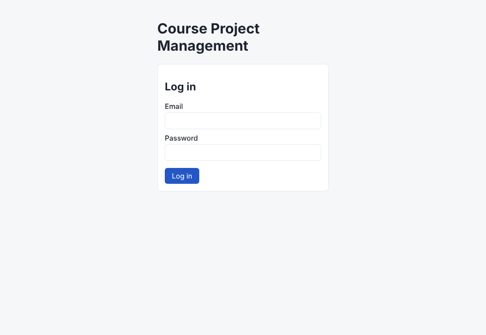

Backend evidence (hiding a button is not authorization):

```
GET /api/teams  (no cookie)
HTTP/1.1 401 Unauthorized
{"error":{"code":"UNAUTHENTICATED","message":"Please log in"}}

POST /api/teams/<alpha>/milestones  (as student S1)
HTTP/1.1 403 Forbidden
{"error":{"code":"FORBIDDEN","message":"Your role cannot perform this operation"}}

GET /api/milestones/<alpha milestone>  (as S3, Team Beta)
HTTP/1.1 404 Not Found
{"error":{"code":"NOT_FOUND","message":"Not found or you do not have access"}}

POST /api/auth/logout  (as S1) -> 204
GET /api/auth/me  (same cookie)
HTTP/1.1 401 Unauthorized
```

## F.3 Build and automated test results

Tested commit: `{{EVIDENCE_COMMIT}}`, 2026-11-05, Node 22.23, PostgreSQL 16.

```
$ npm run build
✓ web built (vite), server compiled (tsc)

$ npm test            # Vitest: unit + API/DB integration on real PostgreSQL
 Test Files  5 passed (5)
      Tests  48 passed (48)      failed 0, skipped 0

$ npm run test:e2e    # Playwright, Chromium
  4 passed                       failed 0, skipped 0
```

Full outputs: `docs/evidence/test-results-{{EVIDENCE_COMMIT}}.txt`, `docs/evidence/e2e-results-{{EVIDENCE_COMMIT}}.txt`.
No test is skipped or disabled.

### AC to test results (all automated)

| AC | Planned test | Actual test (file > name) | Level | Result |
|---|---|---|---|---|
| AC-01 | TEST-01 | `server/tests/api/auth.test.ts` > TEST-01 AC-01 valid login ... | API | Pass |
| AC-02 | TEST-02, TEST-03 | `auth.test.ts` > TEST-02 wrong password ..., TEST-03 unknown email ... | API | Pass |
| AC-03 | TEST-04 | `auth.test.ts` > TEST-04 protected endpoints reject unauthenticated ... | API | Pass |
| AC-04 | TEST-05 | `auth.test.ts` > TEST-05 after logout the old session cookie is rejected | API | Pass |
| AC-05 | TEST-06 | `auth.test.ts` > TEST-06 passwords are stored only as bcrypt hashes ... | API/DB | Pass |
| AC-06 | TEST-07 | `milestones.test.ts` > TEST-07 assigned supervisor creates a milestone ... | API/DB | Pass |
| AC-07 | TEST-08, TEST-U01 | `milestones.test.ts` > TEST-08 ...; `unit/rules.test.ts` > TEST-U01 ... | API, Unit | Pass |
| AC-08 | TEST-09 | `milestones.test.ts` > TEST-09 supervisor cannot create ... unassigned team | API | Pass |
| AC-09 | TEST-10, TEST-20 | `milestones.test.ts` > TEST-10 student cannot create a milestone; `submissions.test.ts` > TEST-20 supervisor cannot submit | API | Pass |
| AC-10 | TEST-11, TEST-12 | `auth.test.ts` > TEST-11, TEST-12; `milestones.test.ts` > TEST-12 another team's milestones | API | Pass |
| AC-11 | TEST-13 | `submissions.test.ts` > TEST-13 student submits and teammates and supervisor retrieve ... | API/DB | Pass |
| AC-12 | TEST-14, TEST-15 | `submissions.test.ts` > TEST-14 second submission rejected; TEST-15 concurrent submissions store exactly one row | API/DB | Pass |
| AC-13 | TEST-16, TEST-U02 | `submissions.test.ts` > TEST-16 ... after the due date; `rules.test.ts` > TEST-U02 | API/DB, Unit | Pass |
| AC-14 | TEST-17, TEST-U03 | `submissions.test.ts` > TEST-17 invalid link or title; `rules.test.ts` > TEST-U03 | API, Unit | Pass |
| AC-15 | TEST-18 | `submissions.test.ts` > TEST-18 a student of another team gets 404 | API | Pass |
| AC-16 | TEST-19 | `submissions.test.ts` > TEST-19 a teammate edits the submission before the deadline | API/DB | Pass |
| AC-17 | TEST-21 | `feedback.test.ts` > TEST-21 assigned supervisor records feedback ... | API/DB | Pass |
| AC-18 | TEST-24, TEST-U02 | `feedback.test.ts` > TEST-24 feedback locks the submission ...; `rules.test.ts` > TEST-U02 | API/DB, Unit | Pass |
| AC-19 | TEST-22, TEST-23 | `feedback.test.ts` > TEST-22 student cannot record feedback; TEST-23 unassigned supervisor gets 404 | API | Pass |
| AC-20 | TEST-25 | `feedback.test.ts` > TEST-25 empty feedback rejected, only once | API | Pass |
| AC-21 | TEST-E2E-01 | `web/e2e/journey.spec.ts` > TEST-E2E-01 ... | E2E | Pass |
| AC-22 | TEST-E2E-02 | `journey.spec.ts` > TEST-E2E-02 ... | E2E | Pass |

Additional automated tests beyond the STS: empty login body (400), malformed team id (404 not 500), milestone status
and ordering, PUT without submission (404), invalid login in UI, field validation in UI.

Manual check MC-01 (NFR-08): `git grep` shows only placeholder/test secrets (`.env.example`, test config);
`server/.env` is git-ignored; the built bundle contains no `SESSION_SECRET`. Result: pass.

### Test excerpt 1: domain rule (BR-06 deadline, TEST-16)

```ts
it('TEST-16 AC-13 submit and edit after the due date are rejected and data is unchanged', async () => {
  const pastDue = await createMilestone(seed, 'alpha', -60_000);
  const s1 = await loginAs('s1');
  const post = await s1.post(`/api/milestones/${pastDue.id}/submission`).send(work);
  expect(post.status).toBe(422);
  expect(post.body.error.code).toBe('DEADLINE_PASSED');
  expect(await prisma.submission.count()).toBe(0);
  // ... existing submission moved past due, then PUT -> 422 and title unchanged in DB
});
```

Result: `✓ TEST-16 AC-13 submit and edit after the due date are rejected and data is unchanged`.

### Test excerpt 2: role and ownership (BR-02, BR-03, TEST-22 and TEST-23)

```ts
it('TEST-22 AC-19 a student cannot record feedback', async () => {
  const res = await (await loginAs('s1')).post(`/api/submissions/${submissionId}/feedback`).send({ comment: 'Great job, us!' });
  expect(res.status).toBe(403);
  expect(await prisma.feedback.count()).toBe(0);
});

it('TEST-23 AC-19 an unassigned supervisor gets 404 and nothing is stored', async () => {
  const res = await (await loginAs('sup2')).post(`/api/submissions/${submissionId}/feedback`).send({ comment: 'Not my team' });
  expect(res.status).toBe(404);
  expect(await prisma.feedback.count()).toBe(0);
});
```

Result: `✓ TEST-22 ...` and `✓ TEST-23 ...` (both pass against the real database).

### TDD evidence: failing before, passing after

| Feature | Red commit (tests only) | Red result | Green commit (implementation) | Green result |
|---|---|---|---|---|
| F-01, F-02 | `1460ce8` 2026-11-05 08:01 | 9 failed, 1 passed (TEST-06 seed hashing already true) | `db97b3d` 08:02 | 10 passed |
| F-03 to F-05 | `6f48185` 2026-11-05 08:03 | 35 failed, 13 passed | `b401c64` 08:05 | 48 passed |

Example from `docs/evidence/tdd/F-03-F-05-red-6f48185.txt`:

```
FAIL  tests/unit/rules.test.ts > TEST-U02 AC-13 AC-18 canChangeSubmission (BR-06, BR-07) > allows changes only strictly before the due time
Error: not implemented
FAIL  tests/api/submissions.test.ts > F-04 team submission > TEST-16 AC-13 submit and edit after the due date ...
AssertionError: expected 404 to be 422
```

After `b401c64`: `✓ TEST-U02 ...`, `✓ TEST-16 ...` (see `F-03-F-05-green-b401c64.txt`).
Note: a few red-phase tests passed by coincidence because a missing route also answers 404 (for example TEST-09,
TEST-12); they assert the same 404 after implementation.

## F.4 Engineering workflow and history

### Specification before implementation

| Commit | Date (UTC+0) | Content |
|---|---|---|
| `ff157fb` | 2026-11-05 07:59 | SRS, features, traceability, SDS, plan, F-01..F-05 contracts, STS, DoD |
| `1460ce8` | 08:01 | F-01/F-02 tests (red) |
| `db97b3d` | 08:02 | F-01/F-02 implementation (green) |
| `6f48185` | 08:03 | F-03..F-05 tests (red) |
| `b401c64` | 08:05 | F-03..F-05 implementation (green) |
| `9e86522` | 08:08 | React UI, E2E tests, README |

### Issues and pull requests

| Issue | Feature / contract | Branch | PR (into `sprint-1`) | Author | Reviewer | Review note | Merged |
|---|---|---|---|---|---|---|---|
| #1 | Parts A-E docs | `docs/baseline-sprint1-contracts` | #4 | {{STUDENT_A}} | {{STUDENT_B}} | {{REVIEW_4}} | {{MERGED_4}} |
| #2 | F-01, F-02 | `feature/F-01-F-02-auth` | #5 | {{STUDENT_A}} | {{STUDENT_B}} | {{REVIEW_5}} | {{MERGED_5}} |
| #3 | F-03, F-04, F-05 | `feature/F-03-F-05-milestone-submission-feedback` | #6 | {{STUDENT_B}} | {{STUDENT_A}} | {{REVIEW_6}} | {{MERGED_6}} |
| - | Release | `sprint-1` -> `main` | {{RELEASE_PR}} | {{STUDENT_A}} | {{STUDENT_B}} | {{REVIEW_REL}} | tag `{{RELEASE_TAG}}` |

{{SCREENSHOTS_GITHUB}}

Final board status: {{BOARD_STATUS}}

## F.5 Contribution table

| Student | Main contributions | Pair work |
|---|---|---|
| {{STUDENT_A}} | {{CONTRIB_A}} | {{PAIR}} |
| {{STUDENT_B}} | {{CONTRIB_B}} | {{PAIR}} |

## F.6 AI-use declaration

| Tool | Tasks assisted | Human responsibility |
|---|---|---|
| Claude (Claude Code) | Drafting SRS/SDS/contract text from our decisions, generating test and implementation code, screenshots, report assembly | Decisions D-01..D-08 made by the team; contracts, tests and diffs reviewed in PRs; tests run and outputs inspected by the team |

## F.7 Known limitations and incomplete work

- No failed or skipped tests on the evidence commit.
- Docker image, CI pipeline and GCP deployment are not part of Deliverable 1 (Lab 5).
- Teams, memberships and supervisor assignments come from seed data only (exclusion D-03).
- The milestone due date is entered in the browser's local time and stored in UTC; the UI always displays Bangkok time.
- Revision requests, milestone editing/closing and grading are Sprint 2 (F-06 to F-08).
- NFR-06 (performance) is not yet measured; planned for Sprint 3 on the deployed instance.

## F.8 Exceptions

{{EXCEPTIONS}}
