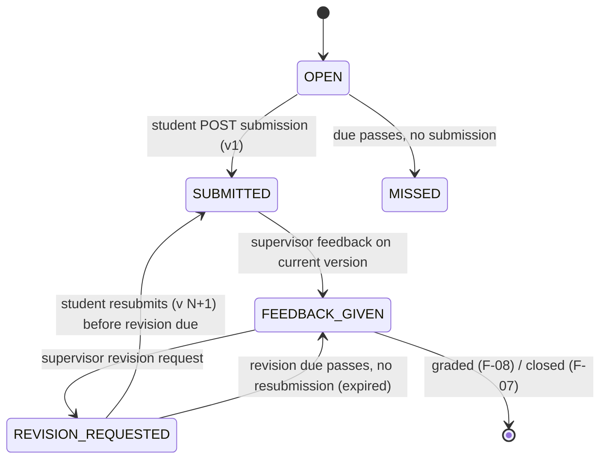

# F-06 Revision and history: feature contract

Version history

| Version | Date | Change |
|---|---|---|
| 0.1 | 2026-11-19 | Part 1 only: keep the original submitter (#55, from Lab 6 UAT finding UF-03). Revision request, resubmission and version history follow in later parts. |
| 0.2 | 2026-11-21 | Parts 2–4: revision request, resubmission as versions, history (FR-11..FR-13, BR-10, BR-11). Feedback moves to versions. |
| 0.3 | 2026-11-25 | Lab 7 CR-01 (#82, #83) note: the 24 h grace window (BR-06 v2) applies only to version 1; resubmissions keep the revision due with no grace; `MISSED` now starts at `dueAt + 24 h`. No other F-06 rule changes. |

Linked requirements: FR-11, FR-12, FR-13, BR-07 (revised: lock per version), BR-08 (per version), BR-09, BR-10, BR-11, BR-01, BR-02, BR-03, NFR-02, NFR-03, NFR-05, NFR-07.
Depends on: F-04, F-05. Hooks used by: F-07 (`MILESTONE_CLOSED`), F-08 (`SUBMISSION_GRADED`, `REVISION_PENDING`).

## Part 1: original submitter

Sprint 1 keeps one `submittedById`, which a teammate's edit replaces (AC-16), so the history lost who
submitted first. Part 1 adds the original submitter; AC-16 is unchanged.

- Data: `Submission.createdById -> User`, set on POST and never changed. Migration
  `20261119150000_submission_created_by` backfills existing rows from `submittedById` (the only author known).
- API: the submission object gains `createdBy: {id, name}`. `submittedBy` keeps meaning "last saved by".
- UI: the submission card reads "Submitted by NAME at TIME · Last updated by NAME at TIME".
- Per-edit history is not kept: edits before feedback stay in place. Each resubmitted version (later parts)
  will carry its own submitter.

| ID | Acceptance criterion |
|---|---|
| AC-23 | Given S1 submits and S2 edits before feedback, GET returns `createdBy` S1, `submittedBy` S2, and the original `submittedAt`. |

| Test | AC | Level | Setup | Steps | Expected |
|---|---|---|---|---|---|
| TEST-26 | AC-23 | API | Alpha milestone before due | S1 POST; S2 PUT; Sup1 GET | `createdBy` S1, `submittedBy` S2, `submittedAt` unchanged |

## Parts 2–4: revision request, resubmission as versions, history (v0.2)

Written before any F-06 part 2–4 code (D2 Part B). Implementation: S2-01 #67 (data + API), S2-02 #68 (UI),
S2-03 #69 (history + E2E).

### Design decisions (agreed 2026-11-21)

1. New table `SubmissionVersion`. The `Submission` row keeps the **current** title/description/link, so F-04 code
   and the milestone page keep working unchanged. Every write to the current version updates both rows in one
   transaction.
2. `Feedback.versionId` (unique): one feedback per version (BR-08). The unique on `Feedback.submissionId` is
   dropped; a plain index stays.
3. Edit window: version 1 = milestone due (BR-06). Version N ≥ 2 = revision due of the request on version N−1
   (BR-11), even if the milestone due has passed. Feedback on the current version locks it (BR-07).
4. One resubmission per revision request. Later changes to that version go through the existing
   `PUT /api/milestones/:id/submission` until it gets feedback.
5. New status `REVISION_REQUESTED`. After the resubmission the status is `SUBMITTED` again.
6. Revision rounds are not limited: feedback on version 2 can be followed by a new request and version 3, and so on,
   until the submission is graded (F-08) or the milestone is closed (F-07).
7. A request whose revision due passes without a resubmission **expires**: the milestone status returns to
   `FEEDBACK_GIVEN`, the supervisor can grade (F-08), and the history shows "Not resubmitted". A second request on
   the same version is not possible (`RevisionRequest.versionId` is unique), so expiry is final for that version.
8. F-07 and F-08 hooks: `MILESTONE_CLOSED` (409) and `SUBMISSION_GRADED` (409) also apply to revision request;
   `MILESTONE_CLOSED` also applies to resubmit.

Terms used below:

- **Current version**: the `SubmissionVersion` with `versionNumber = Submission.currentVersion`.
- **Request on the current version**: the `RevisionRequest` whose `versionId` is the current version (at most one).
- **Request status** (derived, never stored): `RESUBMITTED` when a newer version exists; else `OPEN` when
  `now < dueAt`; else `EXPIRED`.
- **Open request**: a request with status `OPEN`.

### Workflow



Milestone status (`computeMilestoneStatus`), checked in this order: no submission → `OPEN` / `MISSED` (v0.3: `MISSED` only from `dueAt + 24 h`, BR-06 v2, Lab 7 CR-01);
open request on the current version → `REVISION_REQUESTED`; feedback on the current version → `FEEDBACK_GIVEN`;
else `SUBMITTED`. The F-07 "Closed" badge is separate and does not change this status.

**W1 Request revision**

1. Sup1 opens `/milestones/:id` of Team Alpha. The current version has feedback and no request, so the
   "Request revision" card is shown under the feedback card.
2. Sup1 enters a reason and a revision due (Asia/Bangkok) and clicks **Request revision**.
3. System checks, in order: session (401) → role SUPERVISOR (403) → submission exists, valid UUID and team assigned
   to Sup1 (404) → body (400) → milestone closed (409 `MILESTONE_CLOSED`, F-07) → graded (409 `SUBMISSION_GRADED`,
   F-08) → current version has feedback (409 `FEEDBACK_REQUIRED`) → no request on the current version yet
   (409 `REVISION_EXISTS`, also when that request expired).
4. System locks the `Submission` row (`SELECT ... FOR UPDATE`), stores the `RevisionRequest` on the current version
   with `requestedById` = Sup1, returns 201. Two parallel requests store exactly one row (unique `versionId`); the
   other gets 409 `REVISION_EXISTS`.
5. Team members and Sup1 now see status `REVISION_REQUESTED`.

**W2 Resubmit**

1. S2 opens the milestone page and sees the alert "Revision requested: {reason}. Resubmit by {due}." and the
   **Resubmit** form, prefilled from the current version.
2. S2 edits the fields and clicks **Resubmit**.
3. System checks, in order: session (401) → role STUDENT (403) → submission exists, valid UUID and S2 is a member of
   its team (404) → body BR-09 (400) → milestone closed (409 `MILESTONE_CLOSED`, F-07) → request on the current
   version exists; if not: the latest request was answered by the current version → 409 `RESUBMISSION_EXISTS`,
   otherwise 409 `NO_REVISION_REQUEST` → `now < request.dueAt`, else 422 `REVISION_DUE_PASSED`.
4. System locks the `Submission` row, inserts `SubmissionVersion` N+1 (`submittedById` = S2, `submittedAt` = now),
   copies its fields into `Submission` (`title`, `description`, `link`, `submittedById` = S2,
   `currentVersion` = N+1; `createdById` and `submittedAt` unchanged, part 1), returns 201 with the submission.
   Version N, its feedback and the request are not changed. Two parallel resubmissions store exactly one version
   (unique `(submissionId, versionNumber)`); the other gets 409 `RESUBMISSION_EXISTS`.
5. Status is `SUBMITTED`. S1 or S2 can edit version N+1 with PUT until it gets feedback or its revision due passes
   (then 422 `DEADLINE_PASSED`). The supervisor gives feedback with the existing endpoint; it is stored on version
   N+1 and locks it.

**W3 View history**

1. S1, S2 or Sup1 opens the milestone page; the **History** section loads `GET /api/submissions/:id/history`.
2. System checks session (401) → member of the team or assigned supervisor, valid UUID (404).
3. System returns every version in ascending order with its submitter, time, feedback and revision request
   (with derived status). Nothing is written.

### Validation and boundaries

| Field | Rule | Error (`fields.*`) |
|---|---|---|
| `reason` | string, trimmed, 1..1000 characters (BR-10) | missing/empty/whitespace: "Reason is required"; 1001+: "Reason cannot exceed 1000 characters" |
| `dueAt` | ISO 8601 string with offset, strictly after server `now` (BR-10) | missing: "Revision due is required"; not a date: "Invalid revision due"; `<= now`: "Revision due must be in the future" |
| resubmission `title`, `description`, `link` | BR-09, same function `validateSubmissionInput` | same messages as F-04 |

Boundaries: reason 0 / 1 / 1000 / 1001 characters; dueAt = now / now−1 s / now+1 min; resubmit at
revision due −1 s / exactly due / +1 s (only before due accepted, same as BR-06); revision due may be after the
milestone due. Server time decides every deadline.

New error codes and messages:

| Status | Code | Message |
|---|---|---|
| 409 | `FEEDBACK_REQUIRED` | Record feedback on the current version before requesting a revision |
| 409 | `REVISION_EXISTS` | A revision has already been requested for this version |
| 409 | `NO_REVISION_REQUEST` | No revision has been requested for this submission |
| 409 | `RESUBMISSION_EXISTS` | This revision request has already been answered |
| 422 | `REVISION_DUE_PASSED` | Revision due date has passed |

Existing codes keep their messages: `VALIDATION_ERROR`, `UNAUTHENTICATED`, `FORBIDDEN`, `NOT_FOUND`
("Not found or you do not have access"), `SUBMISSION_LOCKED`, `FEEDBACK_EXISTS`, `DEADLINE_PASSED`.

### Data definition

| Table | Column | Type | Rule |
|---|---|---|---|
| `SubmissionVersion` | `id` | uuid PK | |
| | `submissionId` | uuid FK → Submission, cascade | |
| | `versionNumber` | int | 1, 2, 3…; unique `(submissionId, versionNumber)` |
| | `title`, `description?`, `link` | text | same rules as BR-09 |
| | `submittedById` | uuid FK → User | who saved this version last |
| | `submittedAt` | timestamptz | first save of this version |
| | `updatedAt` | timestamptz | `@updatedAt` |
| `RevisionRequest` | `id` | uuid PK | |
| | `submissionId` | uuid FK → Submission, cascade | index |
| | `versionId` | uuid FK → SubmissionVersion, **unique** | the version that was reviewed |
| | `reason` | text | 1..1000 after trim |
| | `dueAt` | timestamptz | strictly in the future at creation |
| | `requestedById` | uuid FK → User | supervisor from session |
| | `createdAt` | timestamptz | default now |
| `Feedback` | `versionId` | uuid FK → SubmissionVersion, **unique** | new; `submissionId` stays (non-unique index) |
| `Submission` | `currentVersion` | int default 1 | number of the latest version |

Write rules: no code path updates or deletes a `SubmissionVersion` other than the current one, a `Feedback`, or a
`RevisionRequest`. Rows are removed only by cascade when a milestone is deleted (no such endpoint today).

Migration `revision_versions`, safe on production data (one SQL migration, runs in a transaction):

1. Create `SubmissionVersion` and `RevisionRequest`; add `Submission.currentVersion` int not null default 1.
2. `INSERT INTO "SubmissionVersion"` one row per existing `Submission` with `id = gen_random_uuid()`,
   `versionNumber = 1`, `title`, `description`, `link` copied, `submittedById = Submission.submittedById` (last saver,
   which may be a teammate after an edit; `Submission.createdById` keeps the original submitter),
   `submittedAt = submittedAt`, `updatedAt = updatedAt`.
3. Add `Feedback.versionId` nullable; `UPDATE` it to the version 1 id of its submission.
4. `SET NOT NULL` on `Feedback.versionId`, add its FK and unique index.
5. Drop the unique index on `Feedback.submissionId`, create a plain index.

Rehearsal: TEST-36 runs it on a database with Sprint 1-shaped rows before it reaches production.

### API definition

| Method + path | Role | Body | Success | Errors |
|---|---|---|---|---|
| `POST /api/submissions/:submissionId/revision-request` | Supervisor (assigned) | `{ "reason": "Add test evidence", "dueAt": "2026-11-30T17:00:00+07:00" }` | 201 `{ revisionRequest: { id, submissionId, versionNumber, reason, dueAt, status, requestedBy:{id,name}, createdAt } }` | 400 `VALIDATION_ERROR` (`fields.reason`, `fields.dueAt`); 401; 403 `FORBIDDEN`; 404 `NOT_FOUND`; 409 `MILESTONE_CLOSED`*; 409 `SUBMISSION_GRADED`*; 409 `FEEDBACK_REQUIRED`; 409 `REVISION_EXISTS` |
| `POST /api/submissions/:submissionId/versions` | Student (member) | `{ "title", "description?", "link" }` | 201 `{ submission }` (same shape as GET milestone `submission`) | 400 `VALIDATION_ERROR` (BR-09); 401; 403; 404; 409 `MILESTONE_CLOSED`*; 409 `NO_REVISION_REQUEST`; 409 `RESUBMISSION_EXISTS`; 422 `REVISION_DUE_PASSED` |
| `POST /api/milestones/:milestoneId/submission` (existing) | Student | unchanged | 201, `submission` gains `currentVersion: 1` | now creates `Submission` and `SubmissionVersion` 1 in one transaction; errors unchanged |
| `PUT /api/milestones/:milestoneId/submission` (existing) | Student | unchanged | 200 | now edits the current version (both rows); deadline = revision due for v ≥ 2 (422 `DEADLINE_PASSED`); 409 `SUBMISSION_LOCKED` when the current version has feedback |
| `POST /api/submissions/:submissionId/feedback` (existing) | Supervisor | unchanged | 201, `feedback` gains `versionNumber` | attaches to the current version (read under the existing row lock); 409 `FEEDBACK_EXISTS` if the current version already has feedback |
| `GET /api/submissions/:submissionId/history` | member or assigned supervisor | – | 200 `{ submission:{id, milestoneId, createdBy}, versions:[…] }` ascending | 401; 404 |
| `GET /api/milestones/:milestoneId` (existing) | unchanged | – | `submission` gains `currentVersion` and `revisionRequest` (request on the current version with its status, or null); `submission.feedback` is the feedback of the current version and gains `versionNumber` (same shape as `POST /feedback`); `milestone.status` may be `REVISION_REQUESTED` | unchanged |
| `GET /api/teams/:teamId/milestones` (existing) | unchanged | – | each milestone `status` is computed with the rules above (open request and feedback of the current version), so the team page badge can show `REVISION_REQUESTED` | unchanged |

\* added by F-07 / F-08; listed here so the contract is complete. Order of checks in each endpoint:
auth (401) → role (403) → scope/UUID (404) → body validation (400) → state rules (409/422), as in W1–W3.

Example: resubmission response (201) and GET milestone `submission`:

```json
{
  "submission": {
    "id": "6f0c…",
    "title": "Sprint 2 demo v2",
    "description": "Added test evidence",
    "link": "https://github.com/example/cpms/pull/80",
    "currentVersion": 2,
    "createdBy": { "id": "…", "name": "Student One" },
    "submittedBy": { "id": "…", "name": "Student Two" },
    "submittedAt": "2026-11-23T09:00:00.000Z",
    "updatedAt": "2026-11-26T10:15:00.000Z",
    "feedback": null,
    "revisionRequest": null
  }
}
```

Example: history (200):

```json
{
  "submission": { "id": "6f0c…", "milestoneId": "a1b2…", "createdBy": { "id": "…", "name": "Student One" } },
  "versions": [
    {
      "versionNumber": 1,
      "title": "Sprint 2 demo", "description": null, "link": "https://github.com/example/cpms/pull/70",
      "submittedBy": { "id": "…", "name": "Student One" },
      "submittedAt": "2026-11-23T09:00:00.000Z", "updatedAt": "2026-11-23T09:00:00.000Z",
      "feedback": { "id": "…", "comment": "Tests are missing", "author": { "id": "…", "name": "Supervisor One" }, "createdAt": "2026-11-24T08:00:00.000Z" },
      "revisionRequest": { "id": "…", "reason": "Add test evidence", "dueAt": "2026-11-30T10:00:00.000Z", "status": "RESUBMITTED", "requestedBy": { "id": "…", "name": "Supervisor One" }, "createdAt": "2026-11-24T08:05:00.000Z" }
    },
    {
      "versionNumber": 2,
      "title": "Sprint 2 demo v2", "description": "Added test evidence", "link": "https://github.com/example/cpms/pull/80",
      "submittedBy": { "id": "…", "name": "Student Two" },
      "submittedAt": "2026-11-26T10:15:00.000Z", "updatedAt": "2026-11-26T10:15:00.000Z",
      "feedback": null,
      "revisionRequest": null
    }
  ]
}
```

### Permission matrix

Fixture per cell: Alpha submission with feedback on version 1 (and an open request for the versions row). S1/S2 =
Alpha members, S3 = Beta student, Sup1 = Alpha supervisor, Sup2 = Gamma supervisor. Each 201 cell is tested on its
own fixture.

| Endpoint | S1 / S2 | S3 | Sup1 | Sup2 | anonymous |
|---|---|---|---|---|---|
| `POST /api/submissions/:id/revision-request` | 403 | 403 | 201 | 404 | 401 |
| `POST /api/submissions/:id/versions` | 201 | 404 | 403 | 403 | 401 |
| `GET /api/submissions/:id/history` | 200 | 404 | 200 | 404 | 401 |

A malformed or unknown `:id` returns 404 for every authenticated role that passes the role check.

### UI definition (English only)

- **Supervisor, milestone page**, under the feedback card when the current version has feedback and no request:
  card "Request revision" with textarea **Reason** (counter "n / 1000", max 1000), datetime input **Revision due**
  (Asia/Bangkok, hint "Asia/Bangkok (UTC+7)", same `+07:00` handling as the milestone form in `team-page.tsx`),
  button **Request revision** (disabled and "Requesting…" while saving). Field errors under each input; other API
  errors in an alert above the button. After 201 the card is replaced by the request block.
- **Everyone, team page and milestone page**: status badge `REVISION_REQUESTED` with the text "Revision requested".
- **Student, open request**: alert "Revision requested: {reason}. Resubmit by {due}." and a **Resubmit** form
  (Title, Description, Link prefilled from the current version, button **Resubmit**, "Resubmitting…" while saving).
  Field errors under each input. After the revision due (request `EXPIRED`): text "Revision due date has passed."
  and no form.
- **Supervisor, open request**: block "Revision requested by {name}: {reason}. Due {time}" and the text
  "Waiting for the team to resubmit".
- **Supervisor, expired request**: the same block with the text "Not resubmitted: revision due date has passed"; the
  "Request revision" card stays hidden (a second request on the same version is not allowed). Status badge
  `FEEDBACK_GIVEN`.
- **Submission card**: "Version {n}" next to the title; existing "Submitted by … · Last updated by …" line unchanged.
- **History section** (below the submission card, shown when a submission exists): one entry per version, oldest
  first, "Version {n} · Submitted by {name} at {time}", its link, its feedback block (or "No feedback yet"), and its
  revision request block "Revision requested by {name}: {reason}. Due {time}" with "Not resubmitted" when `EXPIRED`.
  Only version 1: the entry plus the text "No earlier versions". Loading: skeleton rows. Error: alert "Could not load
  history" with **Retry**.
- Times are shown in Asia/Bangkok with the existing `formatBangkokDateTime` helper (`web/src/lib/api.ts`).

### Acceptance criteria

| ID | Acceptance criterion |
|---|---|
| AC-24 | Given Alpha's submission has feedback on its current version, when Sup1 posts a revision request with a reason and a future due, then the API returns 201, the request is stored with `requestedBy` Sup1, and GET milestone returns status `REVISION_REQUESTED` to S1 and Sup1. |
| AC-25 | A reason that is empty, whitespace only or 1001 characters, or a dueAt that is missing, not a date, now or in the past, returns 400 with field errors and stores nothing; reasons of 1 and 1000 characters are accepted. |
| AC-26 | A request on a submission whose current version has no feedback returns 409 `FEEDBACK_REQUIRED`; a second request on the same version, open or expired, returns 409 `REVISION_EXISTS`; two parallel requests store exactly one. |
| AC-27 | A student gets 403, Sup2 gets 404, a malformed or unknown id gets 404, and a request without a session gets 401; nothing is stored. |
| AC-28 | After a request, S2 resubmits before the revision due: 201, version 2 is stored with `submittedBy` S2, `createdBy` stays S1, `currentVersion` is 2, and version 1 with its feedback is unchanged in the database. |
| AC-29 | A resubmission at or after the revision due returns 422 `REVISION_DUE_PASSED`; a resubmission is accepted when the milestone due has passed but the revision due has not. When the revision due passes without a resubmission, GET milestone returns status `FEEDBACK_GIVEN` and the request status `EXPIRED`. |
| AC-30 | Resubmitting without an open request returns 409 `NO_REVISION_REQUEST`; a second resubmission returns 409 `RESUBMISSION_EXISTS` (two parallel resubmissions store exactly one version); a supervisor gets 403; a student of another team gets 404; S1 can edit version 2 with PUT before it has feedback. |
| AC-31 | Feedback on version 2 is stored on version 2 and locks it (PUT returns 409 `SUBMISSION_LOCKED`); the feedback of version 1 is unchanged. |
| AC-32 | S1, S2 and Sup1 get the full history: every version in ascending order with its submitter, time, feedback and revision request. |
| AC-33 | History for S3 (other team) and Sup2 returns 404, a malformed id 404, no session 401. |
| AC-34 | In the UI the supervisor requests a revision, the student sees the alert and resubmits, and both see the History section with loading, empty and error states. |
| AC-35 | After the migration every existing submission has a version 1 equal to its fields and every existing feedback points to version 1; all Sprint 1 tests still pass. |

### STS (test design)

Fixtures: Sprint 1 seed (`docs/sprints/sprint-1/sts.md`); no new seed data. Levels as in Sprint 1. Past dates
(milestone due, revision due) are set directly through Prisma in the test, never by waiting.

| Test | AC | Level | Precondition / input | Action | Expected result |
|---|---|---|---|---|---|
| TEST-U04 | AC-25 | Unit | fixed `now` | `validateRevisionRequestInput` with reason 0/1/1000/1001 chars, whitespace, dueAt missing/invalid/now/now-1s/now+1min | invalid → `fields.reason` / `fields.dueAt`; valid → trimmed data |
| TEST-28 | AC-24 | API/DB | Alpha milestone +7d, S1 submission, Sup1 feedback | Sup1 POST revision-request | 201; DB row reason/dueAt/requestedById=Sup1/versionId=v1; S1 and Sup1 GET milestone and GET team milestones list status `REVISION_REQUESTED` |
| TEST-29 | AC-25 | API/DB | as TEST-28 | Sup1 POST invalid bodies; then reasons of 1 and 1000 chars (separate fixtures) | 400 + fields, `RevisionRequest` count unchanged; 201 for both valid reasons |
| TEST-30 | AC-26 | API/DB | submission without feedback; then with an open request; then with an expired request | POST; POST again; POST on expired; 2 parallel POSTs | 409 `FEEDBACK_REQUIRED`; 409 `REVISION_EXISTS`; 409 `REVISION_EXISTS`; exactly 1 row after parallel |
| TEST-31 | AC-27 | API | as TEST-28 | S1, Sup2, `not-a-uuid`, random uuid, no cookie | 403, 404, 404, 404, 401; count unchanged |
| TEST-U05 | AC-29, AC-30 | Unit | fixed `now` | `canResubmit` (no request, answered request, open, due −1 s / = / +1 s), `canChangeSubmission` (v1 milestone due; v2 revision due with milestone due past; feedback on current version), `computeMilestoneStatus` (open vs expired request) | reasons `NO_REVISION_REQUEST`, `RESUBMISSION_EXISTS`, `REVISION_DUE_PASSED`, `DEADLINE_PASSED`, `SUBMISSION_LOCKED` as in AC; status `REVISION_REQUESTED` / `FEEDBACK_GIVEN` |
| TEST-32 | AC-28 | API/DB | open request (due +3d) | S2 POST versions | 201; 2 versions; v1 fields + v1 feedback equal to before; Submission.createdById=S1, submittedById=S2, currentVersion=2 |
| TEST-33 | AC-29 | API | revision due set to past via Prisma; second case milestone due past + revision due future | S1 POST versions; S1 GET milestone (first case) | 422 `REVISION_DUE_PASSED`, status `FEEDBACK_GIVEN`, request `EXPIRED`; second case 201 |
| TEST-34 | AC-30 | API/DB | various | no request; resubmit twice; 2 parallel resubmits; Sup1; S3; S1 PUT on v2 | 409 `NO_REVISION_REQUEST`; 409 `RESUBMISSION_EXISTS`; one 201 + one 409, 2 versions; 403; 404; 200 |
| TEST-35 | AC-31 | API/DB | v2 exists | Sup1 feedback; S2 PUT; Sup1 feedback again | 201 with versionId=v2; 409 `SUBMISSION_LOCKED`; 409 `FEEDBACK_EXISTS`; v1 feedback unchanged |
| TEST-36 | AC-35 | DB + manual rehearsal | DB at migration before `revision_versions` with Sprint 1 rows | apply migration; run Sprint 1 suite | every Submission has v1, fields equal; every Feedback.versionId = its v1; Sprint 1 tests pass; output in `docs/evidence/F-06/migration-rehearsal.txt` |
| TEST-37 | AC-32 | API/DB | v1 + feedback + request + v2 + feedback | GET history as S1, S2, Sup1 | 200; 2 versions ascending; authors, feedback, request (status `RESUBMITTED`) correct |
| TEST-38 | AC-33 | API | as TEST-37 | S3, Sup2, malformed, none | 404, 404, 404, 401 |
| TEST-E2E-03 | AC-34 | E2E | seed | full browser flow (see S2-03 #69): Sup1 milestone, S1 submit, Sup1 feedback + request revision, S2 sees alert and resubmits, Sup1 feedback on v2; loading/empty/error checked with route interception | History shows Version 1 and Version 2 |

Coverage: AC-24..AC-35 each have at least one test; every test row points to an AC in this range.

### Layers with no change

Auth (`routes/auth.ts`, `auth-service.ts`), session config, team list and team detail (`GET /api/teams`,
`GET /api/teams/:teamId`), milestone creation (`POST /api/teams/:teamId/milestones`), seed data (no new fixtures).
`GET /api/teams/:teamId/milestones` changes only in how `status` is computed; the team page changes only by the new
status badge value.

### Definition of Done (F-06 parts 2–4)

Product DoD (`docs/sprints/sprint-1/dod.md`) applies. F-06 extra: migration rehearsed on Sprint 1-shaped data
(TEST-36); no code path updates or deletes an older `SubmissionVersion`, `Feedback` or `RevisionRequest`.
