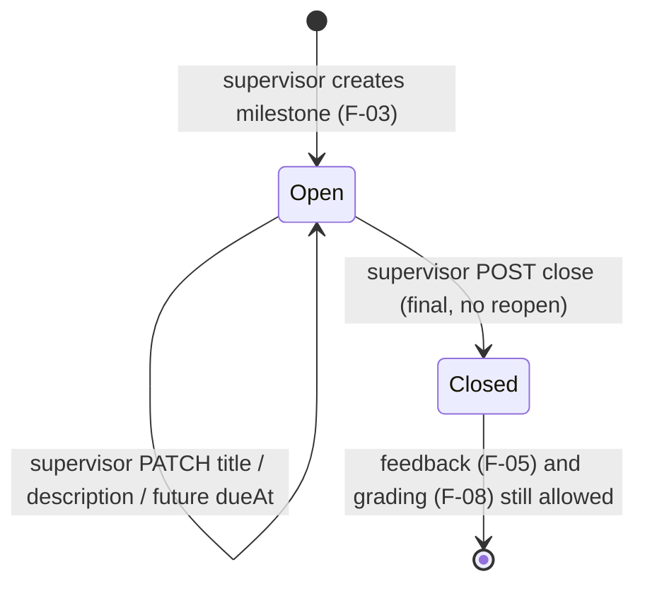

# F-07 Milestone management: feature contract

Version history

| Version | Date | Change |
|---|---|---|
| 0.1 | 2026-11-22 | Initial contract: edit milestone (title, description, due date) and close milestone (FR-14, BR-13). Written before any F-07 code (D2 Part B). |

Linked requirements: FR-14, BR-13, BR-04, BR-06, BR-02, BR-03, NFR-02, NFR-03, NFR-05, NFR-07.
Depends on: F-03, F-04. Interacts with: F-06 (`MILESTONE_CLOSED` on resubmit and revision request), F-08 (grading remains allowed when closed).
Implementation: S2-04 #70.

## Design decisions (agreed 2026-11-21)

1. New nullable columns `Milestone.closedAt` and `Milestone.closedById`. Existing milestones stay open (`null`). No backfill.
2. **Close is final** in Sprint 2 (no reopen endpoint and no delete-milestone endpoint — explicit exclusions).
3. A closed milestone rejects: student submit (`POST /submission`), student edit (`PUT /submission`), student resubmit (`POST /versions`, F-06), supervisor revision request (`POST /revision-request`, F-06), and supervisor milestone edit (`PATCH /milestones/:id`). It **still allows** supervisor feedback (F-05) and grading (F-08): the supervisor can close a milestone and then finish marking.
4. The closed check runs **before** the deadline check, so a milestone that is both closed and past due returns `409 MILESTONE_CLOSED` (not `422 DEADLINE_PASSED`).
5. Changing the due date is allowed only to a time strictly after server `now` (BR-13). Extending a past-due open milestone to a future date reopens the submit window (BR-06 uses the stored `dueAt`). Shortening a due date is allowed as long as the new date is still strictly in the future.
6. `PATCH /api/milestones/:milestoneId` is partial: accepts any subset of `title`, `description`, `dueAt`, with at least one field required. Unknown fields are ignored. Passing `description: ""` or `description: null` clears the description to `null`.
7. `CLOSED` is **not** a new value of `MilestoneStatus`. The milestone object gains `closedAt` (`null` or ISO 8601 string), and the UI renders a separate **Closed** badge next to the status badge.

## Workflow



**W1 Edit milestone**

1. Sup1 opens `/milestones/:id` of an open Team Alpha milestone and clicks **Edit milestone**.
2. Sup1 changes any subset of title, description, or due date (Asia/Bangkok) and clicks **Save changes**.
3. System checks, in order: session (401) → role `SUPERVISOR` (403) → valid UUID and milestone's team assigned to Sup1 (404) → body validation (400 `VALIDATION_ERROR`) → milestone not closed (409 `MILESTONE_CLOSED`).
4. System updates the provided fields in `Milestone` and returns `200` with the updated milestone (including recomputed `status`). Page reloads with the new values; S1 sees them on GET. If a past-due open milestone is extended to a future `dueAt`, students can submit again (BR-06).

**W2 Close milestone**

1. Sup1 opens `/milestones/:id` of an open Team Alpha milestone, clicks **Close milestone**, and confirms in the inline confirmation panel.
2. System checks, in order: session (401) → role `SUPERVISOR` (403) → valid UUID and milestone's team assigned to Sup1 (404) → milestone not already closed (409 `MILESTONE_CLOSED`).
3. System sets `closedAt = now` and `closedById = Sup1.id`, and returns `200` with the updated milestone including `closedAt` and `closedBy`.
4. Both team page and milestone page show the **Closed** badge; Sup1 no longer sees Edit/Close buttons; S1 sees `"This milestone is closed."` and no submission or resubmit form.

**W3 Closed milestone enforcement**

1. A student attempts `POST /api/milestones/:id/submission`, `PUT /api/milestones/:id/submission`, or `POST /api/submissions/:id/versions` (F-06), or a supervisor attempts `PATCH /api/milestones/:id` or `POST /api/submissions/:id/revision-request` (F-06), on a closed milestone.
2. Server checks `milestone.closedAt !== null` before deadline/state checks and rejects with `409 MILESTONE_CLOSED`; nothing is written.
3. Supervisor `POST /api/submissions/:id/feedback` (F-05) and `PUT /api/submissions/:id/grade` (F-08) still succeed when `closedAt` is set.

## Validation, boundaries and errors

Rules for `PATCH /api/milestones/:milestoneId` (reuse `validateMilestoneInput` wording from F-03 / BR-04):

| Field | Rule | Error (`fields.*`) |
|---|---|---|
| body | JSON object with at least one of `title`, `description`, `dueAt` present; unknown keys ignored | `{}` / no recognized keys: `fields.form`: `"At least one field is required"` |
| `title` (if present) | string, trimmed, 3..120 characters (BR-04) | `"Title must be between 3 and 120 characters"` |
| `description` (if present) | `null`, `""` (clears to `null`), or string trimmed ≤ 2000 characters (BR-04) | non-string/non-null: `"Description must be text"`; > 2000: `"Description cannot exceed 2000 characters"` |
| `dueAt` (if present) | ISO 8601 string with offset, strictly after server `now` (BR-04, BR-13) | not a valid date string: `"Invalid due date"`; `<= now`: `"Due date must be in the future"` |

Boundaries:
- `title`: 2 / 3 / 120 / 121 characters (after trim).
- `description`: `null` / `""` / 2000 / 2001 characters (after trim).
- `dueAt`: invalid string / `now - 1 s` / `now` / `now + 1 min`. Server time decides every deadline.
- Closed + past due: `409 MILESTONE_CLOSED` takes precedence over `422 DEADLINE_PASSED`.

New error code:

| Status | Code | Message |
|---|---|---|
| 409 | `MILESTONE_CLOSED` | This milestone is closed |

Existing codes keep their messages: `VALIDATION_ERROR`, `UNAUTHENTICATED`, `FORBIDDEN`, `NOT_FOUND` (`"Not found or you do not have access"`), `DEADLINE_PASSED`, `SUBMISSION_LOCKED`.

## Data definition

| Table | Column | Type | Rule |
|---|---|---|---|
| `Milestone` | `closedAt` | `DateTime? @db.Timestamptz(3)` | `null` = open; set once on close |
| `Milestone` | `closedById` | `String? @db.Uuid` → `User` (`@relation("MilestoneClosedBy")`) | set together with `closedAt` |

Note on Prisma relations: `User` already has the `milestones` relation for milestone creator (`createdById`), so the new relation must use an explicit relation name (`"MilestoneClosedBy"`) on both `Milestone.closedBy` and `User.closedMilestones`.

Migration `milestone_close` (one additive SQL migration):
1. `ALTER TABLE "Milestone" ADD COLUMN "closedAt" TIMESTAMPTZ(3);`
2. `ALTER TABLE "Milestone" ADD COLUMN "closedById" UUID;`
3. Add FK constraint `Milestone.closedById` → `User(id)` (`ON DELETE SET NULL` or `RESTRICT`, matching existing `createdById` FK policy).

Safe on production data: nullable columns require no backfill and no rewrite of existing rows; all existing milestones remain open (`closedAt = null`).

## Domain functions (pure, unit tested)

- `validateMilestoneUpdate(input, now)` in `server/src/domain/milestone.ts`:
  - Returns `{ success: true; data: Partial<{ title: string; description: string | null; dueAt: Date }> } | { success: false; fields: Record<string, string> }`.
  - Rejects empty/no-known-field bodies with `fields.form = "At least one field is required"`.
  - Reuses the exact field error messages from `validateMilestoneInput`.
- `canChangeSubmission(milestone, submission, now)` in `server/src/domain/submission.ts`:
  - `milestone` parameter gains `closedAt?: Date | string | null`.
  - New rejection reason `'MILESTONE_CLOSED'`, checked **first** (before `'DEADLINE_PASSED'` and `'SUBMISSION_LOCKED'`).

## API definition

| Method + path | Role | Body | Success | Errors |
|---|---|---|---|---|
| `PATCH /api/milestones/:milestoneId` | Supervisor (assigned) | Partial `{ "title"?, "description"?, "dueAt"? }`, e.g. `{ "title": "Sprint 2 demo", "dueAt": "2026-12-05T17:00:00+07:00" }` | 200 `{ milestone: { id, teamId, title, description, dueAt, closedAt, status } }` | 400 `VALIDATION_ERROR` (`fields.title`, `fields.description`, `fields.dueAt`, `fields.form`); 401; 403 `FORBIDDEN`; 404 `NOT_FOUND`; 409 `MILESTONE_CLOSED` |
| `POST /api/milestones/:milestoneId/close` | Supervisor (assigned) | none | 200 `{ milestone: { id, teamId, title, description, dueAt, closedAt, closedBy: { id, name }, status } }` | 401; 403 `FORBIDDEN`; 404 `NOT_FOUND`; 409 `MILESTONE_CLOSED` (already closed) |
| `GET /api/milestones/:milestoneId` (existing) | unchanged | – | `milestone` gains `closedAt` (`null` or ISO string) | unchanged |
| `GET /api/teams/:teamId/milestones` (existing) | unchanged | – | each milestone item gains `closedAt` (`null` or ISO string) | unchanged |
| `POST` / `PUT /api/milestones/:milestoneId/submission` (existing) | Student (member) | unchanged | unchanged | **new** 409 `MILESTONE_CLOSED` (checked before 422 `DEADLINE_PASSED`) |
| `POST /api/submissions/:submissionId/versions`, `POST /api/submissions/:submissionId/revision-request` (F-06) | unchanged | unchanged | unchanged | **new** 409 `MILESTONE_CLOSED` |
| `POST /api/submissions/:submissionId/feedback`, `PUT /api/submissions/:submissionId/grade` (F-05, F-08) | Supervisor (assigned) | unchanged | still allowed when milestone is closed | unchanged |

Order of checks in `PATCH` and `POST .../close`: auth (`401`) → role (`403`) → scope/UUID (`404`) → body validation (`400`, PATCH only) → closed state (`409`).

Example: `PATCH /api/milestones/:milestoneId` response (200):

```json
{
  "milestone": {
    "id": "a1b2…",
    "teamId": "t1a2…",
    "title": "Sprint 2 demo",
    "description": "Updated scope",
    "dueAt": "2026-12-05T10:00:00.000Z",
    "closedAt": null,
    "status": "OPEN"
  }
}
```

Example: `POST /api/milestones/:milestoneId/close` response (200):

```json
{
  "milestone": {
    "id": "a1b2…",
    "teamId": "t1a2…",
    "title": "Sprint 2 demo",
    "description": "Updated scope",
    "dueAt": "2026-12-05T10:00:00.000Z",
    "closedAt": "2026-11-26T09:30:00.000Z",
    "closedBy": { "id": "u1…", "name": "Supervisor One" },
    "status": "FEEDBACK_GIVEN"
  }
}
```

## Permission matrix

Fixture per cell: open Team Alpha milestone. S1 = Alpha student, S3 = Beta student, Sup1 = Alpha supervisor, Sup2 = Gamma supervisor.

| Endpoint | S1 (Alpha) | S3 (Beta) | Sup1 (Alpha) | Sup2 (Gamma) | anonymous |
|---|---|---|---|---|---|
| `PATCH /api/milestones/:id` (Alpha) | 403 | 403 | 200 | 404 | 401 |
| `POST /api/milestones/:id/close` (Alpha) | 403 | 403 | 200 | 404 | 401 |

The role check (`403`) runs before the team scope check (`404`), matching F-03 and F-05. A malformed or unknown `:milestoneId` returns `404` for every authenticated supervisor.

## UI definition (English only)

- **Supervisor, milestone page header (open milestone)**: buttons **Edit milestone** and **Close milestone**.
- **Edit form** (inline card, prefilled with current values): **Title**, **Description**, **Due date** (`datetime-local`, Asia/Bangkok, reusing the `+07:00` conversion from `MilestoneForm` in `web/src/pages/team-page.tsx`), buttons **Save changes** (disabled while saving) and **Cancel**. Server field errors (`fields.*`) appear under each input; form-level errors appear in an alert above the actions.
- **Close confirmation** (inline confirm panel — no `window.confirm`, which blocks Playwright automation): text `"Close this milestone? Students will no longer be able to submit or edit."` with buttons **Close milestone** (disabled while saving) and **Cancel**.
- **Closed state (everyone)**: grey badge **Closed** shown next to the status badge on `web/src/pages/team-page.tsx` milestone rows and on `web/src/pages/milestone-page.tsx`.
- **Closed state (student)**: alert `"This milestone is closed."` and no submission, edit, or resubmit form.
- **Closed state (supervisor)**: **Edit milestone** and **Close milestone** buttons are hidden; feedback (F-05) and grading (F-08) controls remain available.
- Dates are displayed in Asia/Bangkok time using `formatBangkokDateTime` (`web/src/lib/api.ts`).

## Acceptance criteria

| ID | Acceptance criterion |
|---|---|
| AC-36 | Given an open Alpha milestone, when Sup1 PATCHes title, description and a future `dueAt`, then 200 is returned, the values are stored, and S1's GET returns the new values. |
| AC-37 | A PATCH with title of 2 or 121 characters, description of 2001 characters, `dueAt` now, in the past or not a date, or an empty body returns 400 with field errors and the row is unchanged; titles of 3 and 120 characters are accepted. |
| AC-38 | Sup1 closes the milestone: 200 with `closedAt` and `closedBy` Sup1; closing again returns 409 `MILESTONE_CLOSED`; a PATCH on a closed milestone returns 409 `MILESTONE_CLOSED`. |
| AC-39 | On a closed milestone, student submit, edit and resubmit and supervisor revision request return 409 `MILESTONE_CLOSED` and change nothing; supervisor feedback still succeeds. |
| AC-40 | A student PATCH or close returns 403; Sup2 on an Alpha milestone gets 404; a malformed id gets 404; no session gets 401. |
| AC-41 | In the UI the supervisor edits and closes a milestone; the team page and milestone page show `"Closed"` and the student sees no submission form. |
| AC-42 | A milestone whose due date has passed, extended by Sup1 to a future due date, accepts a student submission again. |

## STS (test design)

Fixtures: Sprint 1 seed (`docs/sprints/sprint-1/sts.md`); no new seed data. Levels as in Sprint 1. Past dates are set directly through Prisma in tests, never by waiting.

| Test | AC | Level | Precondition / input | Action | Expected result |
|---|---|---|---|---|---|
| TEST-U06 | AC-37, AC-39 | Unit | fixed `now` | `validateMilestoneUpdate` with title 2/3/120/121, description 2000/2001, `dueAt` now/past/invalid/+1min, `{}`; `canChangeSubmission` with `closedAt` set and due past | field errors as listed; valid inputs pass; `MILESTONE_CLOSED` returned before `DEADLINE_PASSED` |
| TEST-39 | AC-36 | API/DB | Alpha milestone +7d | Sup1 PATCH title, description, dueAt; S1 GET milestone | 200; DB row updated; S1 sees new values |
| TEST-40 | AC-37 | API/DB | as TEST-39 | Sup1 PATCH each invalid body (title 2/121, desc 2001, dueAt now/past/invalid, `{}`); then valid titles 3 and 120 chars | 400 + fields, DB row deep-equal to before; 200 for valid 3 and 120 char titles |
| TEST-41 | AC-38 | API/DB | open Alpha milestone | Sup1 POST close; Sup1 POST close again; Sup1 PATCH | 200 with `closedAt` and `closedById=Sup1`; 409 `MILESTONE_CLOSED`; 409 `MILESTONE_CLOSED` |
| TEST-42 | AC-39 | API/DB | milestones prepared before closing (empty; with submission without feedback; with submission + feedback + revision request) | S1 POST submission; S1 PUT submission; S2 POST versions; Sup1 POST revision-request; Sup1 POST feedback on un-reviewed submission | 409 `MILESTONE_CLOSED` ×4, row counts unchanged; feedback returns 201 |
| TEST-43 | AC-40 | API | open Alpha milestone | S1 PATCH, S1 close, Sup2 PATCH, Sup2 close, malformed id, no cookie | 403, 403, 404, 404, 404, 401; DB row unchanged |
| TEST-44 | AC-42 | API/DB | Alpha milestone `dueAt` set to past via Prisma | S1 POST submission → Sup1 PATCH `dueAt` to +7d → S1 POST submission | 422 `DEADLINE_PASSED`, 200, 201 |
| TEST-E2E-04 | AC-41 | E2E | seed | Sup1 edits title + due date, closes milestone via inline confirm; S1 opens team page + milestone page | `"Closed"` badge on team and milestone pages, student sees `"This milestone is closed."` and no form, new title shown |

Coverage: AC-36..AC-42 each have at least one test; every test row points to an AC in this range.

## Layers with no change

Auth (`routes/auth.ts`, `auth-service.ts`), session config, teams listing and detail (`GET /api/teams`, `GET /api/teams/:teamId`), milestone creation (`POST /api/teams/:teamId/milestones`), feedback rules, seed data (no new fixtures).

## Definition of Done (F-07)

Product DoD (`docs/sprints/sprint-1/dod.md`) applies. F-07 extra: every student write path (and supervisor milestone edit / revision request) checks `closedAt` on the **server** (not only hidden in UI).
