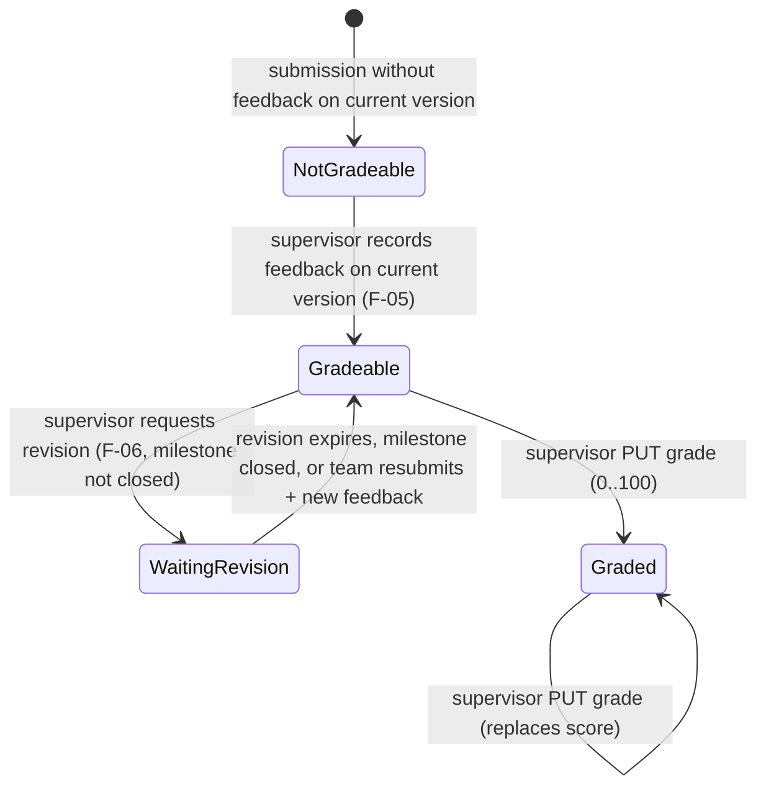

# F-08 Grading: feature contract

Version history

| Version | Date | Change |
|---|---|---|
| 0.1 | 2026-11-23 | Initial contract: supervisor grading and team grade view (FR-15, FR-16, BR-12). Written before any F-08 code (D2 Part B). |

Linked requirements: FR-15, FR-16, BR-12, BR-01, BR-02, BR-03, NFR-02, NFR-03, NFR-05, NFR-07.
Depends on: F-05.
Interacts with:
- F-06 (`REVISION_PENDING` blocks grading only while a revision request on the current version is `OPEN` on an unclosed milestone; an `EXPIRED` request allows grading per F-06 v0.2; once graded, `POST /api/submissions/:id/revision-request` returns `409 SUBMISSION_GRADED`).
- F-07 (grading is allowed on a closed milestone per F-07 v0.1; closing a milestone also unblocks grading even if a prior revision request had a future due date, because students can no longer resubmit).
Implementation: S2-05 #71.

## Design decisions (agreed 21 Nov)

1. **One grade per submission** (table `Grade`, `submissionId` unique). Stores `versionNumber` = `Submission.currentVersion` at grading time.
2. The supervisor can **update** the grade through the same idempotent `PUT` endpoint (create or replace). **Explicit exclusions**: grade change history/audit log, weighted/final course grades, letter grades, and grade export (Sprint 3 F-10 reads grades).
3. Grading requires: feedback on the **current** version (`409 FEEDBACK_REQUIRED`), and **no active open revision request** (`409 REVISION_PENDING`). A request blocks grading only when `revisionRequestStatus === 'OPEN'` **and** `!milestoneClosed` — an `EXPIRED` request (F-06) or a closed milestone (F-07) allows grading.
4. After a grade exists, `POST /api/submissions/:submissionId/revision-request` (F-06) returns `409 SUBMISSION_GRADED` (grade = final decision).
5. Grading is **allowed on a closed milestone** (F-07): the supervisor may close a milestone and then record or update grades.
6. Score must be a JSON **number** that is an integer from `0` to `100`. Strings like `"85"`, decimals like `85.5`, booleans, `null`, and out-of-range values are rejected. No letter grades.
7. Students see the grade of their own team only; other teams get `404` for the milestone (BR-01, D-05, D-08).
8. Grading adds **no** new `MilestoneStatus` value: a graded milestone's `status` stays `FEEDBACK_GIVEN` (matching F-07 Decision 7).

## Workflow



**W1 Record grade**

1. Sup1 opens `/milestones/:id` of Team Alpha. The current submission version has feedback and no active open revision request, so the **Grade** card is shown.
2. Sup1 enters an integer score (e.g. `85`) and clicks **Save grade**.
3. System checks, in order: session (401) → role `SUPERVISOR` (403) → valid UUID and submission's team assigned to Sup1 (404) → body validation (400 `VALIDATION_ERROR`) → inside a transaction locking the `Submission` row, current version has feedback (409 `FEEDBACK_REQUIRED`) → no active open revision request (409 `REVISION_PENDING`).
4. System upserts `Grade` with `score`, `versionNumber = submission.currentVersion`, `gradedById = Sup1.id`, and returns `200` with the grade.
5. Sup1 sees `"Grade: 85 / 100 · Graded by Supervisor One at …"` (using `updatedAt`) and **Edit grade**. Future `POST /revision-request` calls on this submission return `409 SUBMISSION_GRADED`.

**W2 Update grade**

1. Sup1 clicks **Edit grade** on a graded submission, changes `85` to `90`, and clicks **Save grade**.
2. System runs the same checks under the `Submission` row lock and upserts the existing `Grade` row (`score = 90`, `versionNumber = submission.currentVersion` on both create and update, `gradedById = Sup1.id`, `updatedAt = now`, keeping `gradedAt` unchanged). Returns `200`.

**W3 Student views grade**

1. S1 or S2 opens `/milestones/:id` (`GET /api/milestones/:id`).
2. If graded, the page shows `"Grade: 85 / 100"`. If a submission exists without a grade, it shows `"Not graded yet"` (`submission.grade: null`). S3 (other team) gets `404`.

### Concurrency and locking

`PUT /api/submissions/:submissionId/grade` runs inside a database transaction that acquires `SELECT 1 FROM "Submission" WHERE id = $1 FOR UPDATE`, then re-reads the current version's feedback, revision request, and `milestone.closedAt` inside the transaction before upserting `Grade`:
- `PUT /grade` keeps **only** the `Submission` lock (like `POST /feedback` in F-07). Closing a milestone never makes a grade invalid (a stale `closedAt = null` read fails safe as `409 REVISION_PENDING`), and taking only one lock cannot deadlock with F-07's Milestone-then-Submission lock order.
- Parallel `PUT /grade` + `POST /revision-request` (which takes Milestone lock then Submission lock) serialize on the `Submission` row: either the grade commits first (`POST /revision-request` gets `409 SUBMISSION_GRADED`) or the revision request commits first (`PUT /grade` gets `409 REVISION_PENDING`). Both never succeed together.
- Parallel `PUT /grade` + `POST /versions` (resubmission) also serialize on the `Submission` row, so a grade cannot land on a version being replaced.
- Parallel `PUT /grade` + `PUT /grade` serialize on the `Submission` lock and `upsert` on the unique `submissionId`, leaving exactly one `Grade` row.

## Validation, boundaries and errors

| Field | Rule | Error (`fields.*`) |
|---|---|---|
| body | plain JSON object with `score` | non-object or missing `score`: `fields.score`: `"Score must be a whole number from 0 to 100"` |
| `score` | JSON number (`typeof score === 'number'`), `Number.isInteger(score)`, `0 <= score <= 100` (BR-12) | `"Score must be a whole number from 0 to 100"` |

Boundaries:
- API / JSON inputs: `-1` (400), `0` (200), `1` (200), `99` (200), `100` (200), `101` (400), `85.5` (400), `"85"` (400), `null` (400), `true`/`false` (400), `{}` (400). Note: JSON `85.0` parses to integer `85` in JavaScript and is accepted.
- Unit-only inputs (`validateGradeInput`): `NaN`, `Infinity`, `undefined`, non-object values.

Error codes and messages:

| Status | Code | Message |
|---|---|---|
| 409 | `FEEDBACK_REQUIRED` | Record feedback before grading |
| 409 | `REVISION_PENDING` | A revision is requested; grade after the team resubmits and you give feedback |
| 409 | `SUBMISSION_GRADED` | Submission has already been graded |

Existing codes keep their messages: `VALIDATION_ERROR`, `UNAUTHENTICATED`, `FORBIDDEN`, `NOT_FOUND` (`"Not found or you do not have access"`).

## Data definition

| Table | Column | Type | Rule |
|---|---|---|---|
| `Grade` | `id` | `String @id @default(uuid()) @db.Uuid` | PK |
| | `submissionId` | `String @unique @db.Uuid` → `Submission` (`onDelete: Cascade`) | one grade per submission |
| | `score` | `Int` | 0..100; enforced by API and DB CHECK |
| | `versionNumber` | `Int` | `Submission.currentVersion` at grading time (set on create and update) |
| | `gradedById` | `String @db.Uuid` → `User` (`onDelete: Restrict`) | supervisor from `req.user` (last saver) |
| | `gradedAt` | `DateTime @default(now()) @db.Timestamptz(3)` | first grading time (unchanged on update) |
| | `updatedAt` | `DateTime @updatedAt @db.Timestamptz(3)` | last update time |

Migration `grade` (one additive SQL migration):
1. Create table `"Grade"` with PK `id`, unique index on `"submissionId"`, FK `"submissionId"` → `"Submission"(id) ON DELETE CASCADE`, FK `"gradedById"` → `"User"(id) ON DELETE RESTRICT`.
2. Add score range CHECK constraint by hand in the migration SQL:
   ```sql
   ALTER TABLE "Grade" ADD CONSTRAINT "Grade_score_range_chk"
     CHECK ("score" >= 0 AND "score" <= 100);
   ```

Safe on production data: new table only; no existing rows modified.

## Domain functions (pure, unit tested) — `server/src/domain/grade.ts`

- `validateGradeInput(input: unknown)`:
  - Returns `{ success: true; data: { score: number } } | { success: false; fields: { score: string } }`.
  - Accepts only finite integers `0..100` where `typeof raw.score === 'number'`.
- `canGrade(state: { currentVersionHasFeedback: boolean; revisionRequestStatus: 'OPEN' | 'EXPIRED' | 'RESUBMITTED' | null; milestoneClosed: boolean })`:
  - Returns `{ allowed: true } | { allowed: false; reason: 'FEEDBACK_REQUIRED' | 'REVISION_PENDING' }`.
  - Checks `currentVersionHasFeedback` **first** (`FEEDBACK_REQUIRED`), then `revisionRequestStatus === 'OPEN' && !milestoneClosed` (`REVISION_PENDING`).

## API definition

| Method + path | Role | Body | Success | Errors |
|---|---|---|---|---|
| `PUT /api/submissions/:submissionId/grade` | Supervisor (assigned) | `{ "score": 85 }` | 200 `{ grade: { score, versionNumber, gradedBy: { id, name }, gradedAt, updatedAt } }` | 400 `VALIDATION_ERROR` (`fields.score`); 401; 403 `FORBIDDEN`; 404 `NOT_FOUND`; 409 `FEEDBACK_REQUIRED`; 409 `REVISION_PENDING` |
| `GET /api/milestones/:milestoneId` (existing) | member / assigned supervisor | – | `submission.grade` = grade object above or `null` | unchanged |
| `POST /api/submissions/:submissionId/revision-request` (F-06) | Supervisor (assigned) | unchanged | unchanged | **new** 409 `SUBMISSION_GRADED`; full state check order: `MILESTONE_CLOSED` (milestone lock) → `SUBMISSION_GRADED` (submission lock) → `FEEDBACK_REQUIRED` → `REVISION_EXISTS` |

Check order in `PUT /api/submissions/:submissionId/grade`: auth (`401`) → role (`403`) → scope/UUID (`404`) → body validation (`400`) → `Submission` lock + state rules (`409`).

Example: `PUT /api/submissions/:submissionId/grade` response (200) and `GET /api/milestones/:milestoneId` `submission.grade`:

```json
{
  "grade": {
    "score": 85,
    "versionNumber": 1,
    "gradedBy": { "id": "u1…", "name": "Supervisor One" },
    "gradedAt": "2026-11-26T11:00:00.000Z",
    "updatedAt": "2026-11-26T11:00:00.000Z"
  }
}
```

## Permission matrix

Fixture per cell: Team Alpha submission with feedback on the current version and no active open revision request. S1/S2 = Alpha students, S3 = Beta student, Sup1 = Alpha supervisor, Sup2 = Gamma supervisor.

| Endpoint | S1 / S2 (Alpha) | S3 (Beta) | Sup1 (Alpha) | Sup2 (Gamma) | anonymous |
|---|---|---|---|---|---|
| `PUT /api/submissions/:id/grade` (Alpha) | 403 | 403 | 200 | 404 | 401 |
| `GET /api/milestones/:id` (Alpha, sees grade) | 200 | 404 | 200 | 404 | 401 |

The role check (`403`) runs before the scope check (`404`). A malformed or unknown `:submissionId` returns `404` for every authenticated supervisor.

## UI definition (English only) — `web/src/pages/milestone-page.tsx`

- **Supervisor, no submission or current version has no feedback**: no **Grade** card is shown.
- **Supervisor, current version has feedback and no active open revision request (including on a closed milestone)**: card **Grade** with number input **Score (0–100)**, button **Save grade** (disabled / `"Saving…"` while saving), field error text under the input, other API errors in an alert above the button.
  - **Input parsing rule**: an empty/whitespace input is **never** coerced to `0` (`Number("") === 0` pitfall); the client sends `{ "score": null }` so the server returns `400 fields.score` (or disables **Save grade** while empty). Non-integer input like `"85.5"` is parsed as `85.5` (not rounded on the client) so the server rejects it with `400 fields.score`.
- **Supervisor, after save**: `"Grade: {score} / 100 · Graded by {name} at {time}"` where `{time}` is `grade.updatedAt` formatted in Asia/Bangkok with `formatBangkokDateTime` (so author and time both reflect the last save), plus button **Edit grade** (opens the form prefilled with the current score, with **Save grade** and **Cancel**).
- **Supervisor, active open revision request (milestone not closed)**: text `"Grading is available after the team resubmits and you give feedback."` (no grade form).
- **Student (only when a submission exists)**: `"Grade: {score} / 100"` when graded, or `"Not graded yet"` when `submission.grade === null`.

## Acceptance criteria

| ID | Acceptance criterion |
|---|---|
| AC-43 | Given an Alpha submission with feedback on its current version (including on a closed milestone, after an expired revision request, or on a closed milestone with a prior open revision request), when Sup1 PUTs score 85, then 200 is returned and the grade is stored with `gradedBy` Sup1, `gradedAt`, and the current `versionNumber`. |
| AC-44 | A score of `-1`, `101`, `85.5`, `"85"`, `null`, boolean, or missing returns 400 with `fields.score` and stores nothing; scores `0` and `100` are accepted. |
| AC-45 | Grading when the current version has no feedback returns 409 `FEEDBACK_REQUIRED`; grading while a revision request is open on an unclosed milestone returns 409 `REVISION_PENDING`; a revision request after a grade returns 409 `SUBMISSION_GRADED`; parallel grade and revision request never both succeed. |
| AC-46 | Sup1 changes the grade from 85 to 90: 200, there is still exactly one `Grade` row, with score 90, unchanged `gradedAt`, and a later `updatedAt`; two parallel grade PUTs leave exactly one row. |
| AC-47 | A student PUT returns 403; Sup2 on an Alpha submission gets 404; a malformed or unknown id gets 404; no session gets 401; nothing is stored. |
| AC-48 | S1 and S2 see the grade in `GET /api/milestones/:id` and on the milestone page; S3 gets 404 for the Alpha milestone; an ungraded submission returns `grade: null` and shows `"Not graded yet"`. |

## STS (test design)

Fixtures: Sprint 1 seed (`docs/sprints/sprint-1/sts.md`); no new seed data. Levels as in Sprint 1.

| Test | AC | Level | Precondition / input | Action | Expected result |
|---|---|---|---|---|---|
| TEST-U07 | AC-44, AC-45 | Unit | – | `validateGradeInput` with `-1`, `0`, `1`, `99`, `100`, `101`, `85.5`, `"85"`, `null`, `undefined`, `NaN`, `true`, `{}`; `canGrade` across feedback (`true`/`false`) × request (`null`/`OPEN`/`EXPIRED`/`RESUBMITTED`) × `milestoneClosed` (`false`/`true`) | `0`/`1`/`99`/`100` pass, others return `fields.score`; `canGrade` checks `FEEDBACK_REQUIRED` first, returns `REVISION_PENDING` only when `OPEN` + `!milestoneClosed`, and allows `OPEN` + `milestoneClosed: true` and `EXPIRED` |
| TEST-45 | AC-43 | API/DB | (1) Alpha milestone +7d, S1 submission, Sup1 feedback; (2) same on a **closed** milestone; (3) same with an **expired** revision request; (4) feedback + revision request with future `dueAt` (`OPEN`), then milestone **closed** | Sup1 PUT `85` on each | 200 on all 4; DB row `score = 85`, `gradedById = Sup1`, `versionNumber = 1` |
| TEST-46 | AC-44 | API/DB | as TEST-45 (1) | Sup1 PUT each invalid body (`-1`, `101`, `85.5`, `"85"`, `null`, `true`, `{}`); then `0`; then `100` | 400 + `fields.score`, `Grade` count 0; then 200 `score = 0`; 200 `score = 100` |
| TEST-47 | AC-45 | API/DB | (a) submission without feedback; (b) feedback + open revision request (unclosed milestone); (c) graded submission; (d) fresh feedback-given submission | (a) PUT grade; (b) PUT grade; (c) POST revision-request; (d) parallel PUT grade + POST revision-request | (a) 409 `FEEDBACK_REQUIRED`; (b) 409 `REVISION_PENDING`; (c) 409 `SUBMISSION_GRADED`; (d) one 200/201 and one 409, never both succeeding |
| TEST-48 | AC-46 | API/DB | graded `85` | wait ~5 ms, PUT `90`; then 2 parallel PUTs (`80`, `95`) | 200; `count({ where: { submissionId } }) === 1`; `score = 90`, `gradedAt` unchanged, `updatedAt > gradedAt`; after parallel PUTs, count still 1 and final `score ∈ {80, 95}` |
| TEST-49 | AC-47 | API | as TEST-45 (1) | S1 PUT, Sup2 PUT, `not-a-uuid`, unknown uuid, no cookie | 403, 404, 404, 404, 401; `Grade` count 0 |
| TEST-50 | AC-48 | API | graded `85` submission + another ungraded submission | GET milestone as S1, S2, S3 | S1 & S2 see `grade.score = 85`; S3 gets 404; ungraded submission returns `grade: null` |
| TEST-E2E-05 | AC-48 | E2E | seed | Sup1 records feedback → submits empty score (verifies not saved as 0) → saves grade `85` → edits grade to `90`; S1 opens milestone (plus checks ungraded milestone shows `"Not graded yet"`) | empty input rejected (not saved as 0); `"Grade: 85 / 100"` then `"Grade: 90 / 100"` visible; ungraded shows `"Not graded yet"` |

Coverage: AC-43..AC-48 each have at least one test; every test row points to an AC in this range.

## Layers with no change

Auth (`routes/auth.ts`, `auth-service.ts`), session config, teams routes and `team-service.ts`, milestone creation (`POST /api/teams/:teamId/milestones`), feedback validation, seed data (no new fixtures).

## Definition of Done (F-08)

Product DoD (`docs/sprints/sprint-1/dod.md`) applies. F-08 extra: `gradedById` is always taken from `req.user` (never from the request body); DB CHECK constraint `Grade_score_range_chk` (`0..100`) is present in the migration SQL.
