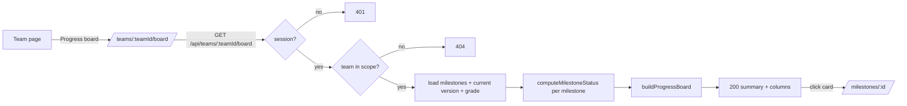

# F-09 Team progress board: feature contract

Version history

| Version | Date | Change |
|---|---|---|
| 0.1 | 2026-11-27 | Initial contract: team progress board and team progress summary (FR-17, FR-19). Written before any F-09 code (D2 Part C). |

Linked requirements: FR-17, FR-19, BR-01, BR-02, BR-06 (v2, read only), NFR-02, NFR-03, NFR-05, NFR-07.
Depends on: F-03 (milestones), F-04 (submission), F-05 (feedback), F-06 (versions, revision requests), F-07 (`closedAt`), F-08 (grades).
Interacts with: F-10 (reuses the summary counting rules of this contract).
Implementation: S3-01 #106.

## Design decisions (agreed 27 Nov)

1. The board is **read-only**. No new table, no migration, no write endpoint. Every value is derived from existing rows.
2. The column of a milestone is its existing `status` from `computeMilestoneStatus()` (F-03, F-06, BR-06 v2). There is
   **one source of truth**: the board never re-implements the status rule.
3. Five columns, always present, in this order: `OPEN`, `SUBMITTED`, `REVISION_REQUESTED`, `FEEDBACK_GIVEN`, `MISSED`.
   Inside a column, cards are sorted by `dueAt` ascending (same order as `GET /api/teams/:teamId/milestones`).
4. **Closed is a badge, not a column** (matches F-07 decision 7). A closed milestone stays in the column of its status.
5. A card shows: title, due date (Asia/Bangkok), current version number (or none), grade score (or none), Closed badge,
   Late badge (`lateAt`, Lab 7). Clicking a card opens `/milestones/:milestoneId`.
6. The grade on a card is the grade of the milestone's submission (one grade per submission, F-08 D-11), or `null`.
7. The progress summary (FR-19) is shown above the board: total milestones, count per status, closed count, graded count,
   average score of graded milestones (rounded to 1 decimal, `null` when nothing is graded).
8. Team members (students) and the assigned supervisor see **the same** board and summary (FR-17). There is no
   role-specific content and no 403 case: anyone outside the team scope gets 404 (BR-01, BR-02).
9. New endpoint `GET /api/teams/:teamId/board` returning `{ summary, columns }`. The grouping and counting are pure
   domain functions so F-10 can reuse them.
10. New UI route `/teams/:teamId/board`, reached by a **Progress board** link on the team page. The existing team page
    and milestone list are not changed otherwise (keeps Sprint 1/2 regression stable).

**Explicit exclusions**: drag and drop, changing status from the board, filters, cross-team views (F-10), export, charts.

## Workflow

**W1 Student views the board**

1. S1 (Team Alpha) opens `/teams/:alphaId` and clicks **Progress board**.
2. Web calls `GET /api/teams/:alphaId/board`.
3. System checks: session (401) → team scope (404 for a team the user is not a member/supervisor of, or a malformed id).
4. System loads the team's milestones with the submission's current version (feedback, revision request), `lateAt`
   and grade, computes each status with `computeMilestoneStatus(now)`, then `buildProgressBoard(cards)`.
5. Page shows the summary and the five columns with cards. S1 clicks a card and lands on the milestone page.

**W2 Supervisor views the board**

Same as W1 for Sup1 on Alpha (or Beta). The response body is identical to the student's for the same moment.

**W3 Board follows the data**

When the data changes elsewhere (submit, feedback, revision request, resubmit, grade, close, due date edit, time passing
the grace window), the next GET shows the milestone in its new column. The board holds no state of its own.



## Validation, boundaries and errors

No request body and no query parameters (unknown query parameters are ignored).

| Input | Rule | Result |
|---|---|---|
| `:teamId` | valid UUID of a team in the user's scope | otherwise `404 NOT_FOUND` (`"Not found or you do not have access"`), same as `GET /api/teams/:teamId` |
| session | required | `401 UNAUTHENTICATED` |

Boundaries:
- Team with **no milestones**: 200, all five columns present with empty arrays, summary counts `0`, `averageScore: null`.
- Milestone exactly at the end of the grace window (`now = dueAt + 24 h`) without submission: `MISSED` (BR-06 v2 rule
  `now >= graceEndsAt`); one millisecond earlier: `OPEN`. (Covered by the existing `computeMilestoneStatus` tests;
  TEST-U08 re-checks the column placement.)
- Revision request whose `dueAt` has passed: status is `FEEDBACK_GIVEN` (F-06 rule), so the card moves out of
  `REVISION_REQUESTED`.
- Average score: graded scores `85, 90` → `87.5`; `85, 90, 91` → `88.7` (half-up rounding to 1 decimal); one grade `0`
  → `0` (not `null`).

Error codes: no new codes. Existing `UNAUTHENTICATED` (401) and `NOT_FOUND` (404) keep their messages.

## Data definition

No change. No migration. Reads: `Milestone` (`dueAt`, `closedAt`), `Submission` (`lateAt`, `currentVersion`),
`SubmissionVersion` (current version with `Feedback` and `RevisionRequest`), `Grade` (`score`).

## Domain functions (pure, unit tested) — `server/src/domain/board.ts`

```ts
type BoardCard = {
  id: string; title: string; dueAt: string; status: MilestoneStatus;
  closedAt: string | null; lateAt: string | null;
  versionNumber: number | null; score: number | null;
};

type ProgressSummary = {
  total: number;
  byStatus: Record<MilestoneStatus, number>; // all five keys, 0 when empty
  closed: number;
  graded: number;                            // cards with score !== null
  averageScore: number | null;               // 1 decimal, half-up; null when graded === 0
};

type ProgressBoard = {
  summary: ProgressSummary;
  columns: { status: MilestoneStatus; cards: BoardCard[] }[]; // fixed order, five entries
};
```

- `BOARD_COLUMNS: readonly MilestoneStatus[]` = `['OPEN', 'SUBMITTED', 'REVISION_REQUESTED', 'FEEDBACK_GIVEN', 'MISSED']`.
- `summarizeProgress(cards: BoardCard[]): ProgressSummary` (exported for F-10).
- `buildProgressBoard(cards: BoardCard[]): ProgressBoard`: places each card in the column of its `status`, sorts each
  column by `dueAt` ascending (ties by `title`), and adds `summarizeProgress(cards)`.

Service: `getTeamBoard(teamId, now)` in `server/src/services/board-service.ts` reuses the milestone query of
`listTeamMilestones` (same `include`, plus `grade: { select: { score: true } }`) and maps rows to `BoardCard`.

## API definition

| Method + path | Role | Body | Success | Errors |
|---|---|---|---|---|
| `GET /api/teams/:teamId/board` | Student member of the team, or its assigned supervisor | – | 200 `{ summary, columns }` | 401 `UNAUTHENTICATED`; 404 `NOT_FOUND` |

Check order: auth (`401`) → team scope / UUID (`404`, existing `teamsRouter.use('/:teamId')` middleware).

Example response (200):

```json
{
  "summary": {
    "total": 3,
    "byStatus": { "OPEN": 1, "SUBMITTED": 0, "REVISION_REQUESTED": 0, "FEEDBACK_GIVEN": 1, "MISSED": 1 },
    "closed": 1,
    "graded": 1,
    "averageScore": 85
  },
  "columns": [
    { "status": "OPEN", "cards": [
      { "id": "m1…", "title": "Final demo", "dueAt": "2026-12-10T10:00:00.000Z", "status": "OPEN",
        "closedAt": null, "lateAt": null, "versionNumber": null, "score": null } ] },
    { "status": "SUBMITTED", "cards": [] },
    { "status": "REVISION_REQUESTED", "cards": [] },
    { "status": "FEEDBACK_GIVEN", "cards": [
      { "id": "m2…", "title": "Proposal", "dueAt": "2026-11-20T10:00:00.000Z", "status": "FEEDBACK_GIVEN",
        "closedAt": "2026-11-26T09:00:00.000Z", "lateAt": null, "versionNumber": 2, "score": 85 } ] },
    { "status": "MISSED", "cards": [
      { "id": "m3…", "title": "Design review", "dueAt": "2026-11-18T10:00:00.000Z", "status": "MISSED",
        "closedAt": null, "lateAt": null, "versionNumber": null, "score": null } ] }
  ]
}
```

No other endpoint changes.

## Permission matrix

Seed: S1/S2 = Alpha students, S3/S4 = Beta students, Sup1 = Alpha and Beta supervisor, Sup2 = Gamma supervisor.

| Endpoint | S1 / S2 (Alpha) | S3 (Beta) | Sup1 (Alpha) | Sup2 (Gamma) | anonymous |
|---|---|---|---|---|---|
| `GET /api/teams/:alphaId/board` | 200 | 404 | 200 | 404 | 401 |

A malformed or unknown `:teamId` returns 404 for every authenticated user. The endpoint writes nothing.

## UI definition (English only) — `web/src/pages/board-page.tsx` (new), `web/src/pages/team-page.tsx` (link only)

- Route `/teams/:teamId/board` inside `RequireAuth` in `web/src/App.tsx`.
- Team page: link/button **Progress board** in the page header (both roles).
- Board page header: title **Progress board**, the team name, link **Back to team**.
- Summary row (cards): **Milestones** `{total}`, **Graded** `{graded} / {total}`, **Average score** `{averageScore}` or
  `–` when `null`, **Closed** `{closed}`.
- Five columns with headings **Open**, **Submitted**, **Revision requested**, **Feedback given**, **Missed** and the count,
  e.g. `Open (1)`. Reuse `milestone-status-badge.tsx` labels and colours. Columns stack vertically on small screens.
- Card: title (link to `/milestones/:id`), `Due {formatBangkokDateTime(dueAt)}`, `Version {n}` when `versionNumber` is
  not null, `Score {score} / 100` when graded, `closed-badge.tsx` when `closedAt`, `late-badge.tsx` when `lateAt`.
- Empty column: muted text **None**.
- States (NFR-07): loading skeleton/spinner while fetching; team with no milestones → `EmptyState` with message
  **No milestones yet.** (columns hidden); API error → `ErrorState` (404 shows the existing not-found message).

## Acceptance criteria

| ID | Acceptance criterion |
|---|---|
| AC-53 | Given Team Alpha milestones stored in each status (open, submitted, revision requested, feedback given, missed) and one closed milestone, when S1 GETs `/api/teams/:alphaId/board`, then 200 is returned with the five columns in the fixed order, every milestone appears in exactly one column equal to its `computeMilestoneStatus` result, cards are sorted by `dueAt`, and the closed milestone keeps its status column with `closedAt` set. |
| AC-54 | The `summary` counts total, per status (all five keys), closed and graded milestones, and `averageScore` is the mean of graded scores rounded half-up to 1 decimal; a team with no milestones returns zeros, five empty columns and `averageScore: null`. |
| AC-55 | Cards reflect stored data: `versionNumber` is the current version (2 after a resubmission), `score` is the stored grade (null when ungraded), `lateAt` is the stored late time; after Sup1 grades or a revision request expires, the next GET shows the new score or column. |
| AC-56 | S1, S2 and Sup1 get 200 and identical bodies for Alpha; S3 and Sup2 get 404; a malformed or unknown team id gets 404; no session gets 401; a GET changes no rows. |
| AC-57 | In the UI a student and a supervisor open **Progress board** from the team page and see the summary and five columns with the right cards; a card opens its milestone page; a team with no milestones shows **No milestones yet.**; an API error shows the error state. |

## STS (test design)

Fixtures: Sprint 1 seed (`docs/sprints/sprint-1/sts.md`) plus milestones/submissions created in each test through
Prisma (status inputs) or the API (state changes). No new seed data.

| Test | AC | Level | Precondition / input | Action | Expected result |
|---|---|---|---|---|---|
| TEST-U08 | AC-53, AC-54 | Unit | hand-built `BoardCard[]`: one per status, two `OPEN` with dues out of order, one closed, graded scores `85, 90` then `85, 90, 91`, one score `0`, empty array | `buildProgressBoard`, `summarizeProgress` | five columns in fixed order; each card in its status column; `OPEN` sorted by `dueAt`; closed card stays in its column and `closed = 1`; `averageScore` `87.5`, `88.7`, `0`; empty → all zero, five empty columns, `averageScore: null` |
| TEST-57 | AC-53 | API/DB | Alpha: (a) open +7d no submission; (b) submitted; (c) feedback + open revision request due +3d; (d) feedback given and **closed**; (e) due −2d (past grace) no submission | S1 GET board | 200; (a) `OPEN`, (b) `SUBMITTED`, (c) `REVISION_REQUESTED`, (d) `FEEDBACK_GIVEN` with `closedAt`, (e) `MISSED`; each id appears once; column order fixed |
| TEST-58 | AC-54 | API/DB | TEST-57 fixture with (d) graded 85 and (b) feedback + graded 90; Beta has no milestones | S1 GET Alpha board; S3 GET Beta board | Alpha `total 5`, `byStatus` matches, `closed 1`, `graded 2`, `averageScore 87.5`; Beta `total 0`, five empty columns, `averageScore null` |
| TEST-59 | AC-55 | API/DB | Alpha milestone: S1 submits, Sup1 feedback, Sup1 revision request, S2 resubmits (v2), Sup1 feedback, Sup1 PUT grade 88; second milestone with `lateAt` set; third with revision request whose `dueAt` is moved to the past via Prisma | S1 GET board after each step that matters | card 1 `versionNumber 2`, `score 88` in `FEEDBACK_GIVEN`; card 2 `lateAt` equals DB value; card 3 in `FEEDBACK_GIVEN` (expired request), not `REVISION_REQUESTED` |
| TEST-60 | AC-56 | API | TEST-57 fixture | GET Alpha board as S1, S2, S3, Sup1, Sup2, no cookie; `not-a-uuid` and an unknown uuid as Sup1 | 200, 200, 404, 200, 404, 401; 404, 404; S1, S2 and Sup1 bodies deep-equal (same `now`) |
| TEST-61 | AC-56 | API/DB | TEST-57 fixture | count rows of `Milestone`, `Submission`, `SubmissionVersion`, `Feedback`, `RevisionRequest`, `Grade`; GET board 3 times as S1 and Sup1; count again | counts identical before and after |
| TEST-E2E-08 | AC-57 | E2E | seed + one milestone created and submitted in the test; Gamma team with no milestones (Sup2) | S1: team page → **Progress board** → card in **Submitted** → click → milestone page; Sup1 opens the same board; Sup2 opens Gamma board; route interception returns 500 for the board API | S1 and Sup1 see the summary and the card under **Submitted**; click lands on the milestone page; Gamma shows **No milestones yet.**; intercepted 500 shows the error state |

Coverage: AC-53..AC-57 each have at least one test; every test row points to an AC in this range.

## Layers with no change

Database schema and migrations, seed data, auth and session, all existing endpoints (teams, milestones, submissions,
feedback, revision, grade), `computeMilestoneStatus()` and BR-06 v2, milestone page.

## Definition of Done (F-09)

Product DoD (`docs/sprints/sprint-1/dod.md`) applies. F-09 extra: the board calls `computeMilestoneStatus()` and never
duplicates the status rule; the endpoint is covered by an access test for every cell of the permission matrix; TDD
red/green outputs are saved under `docs/evidence/F-09/`; all Sprint 1 and Sprint 2 tests still pass unchanged.
