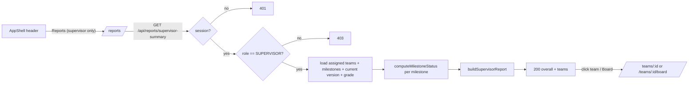

# F-10 Supervisor summary report: feature contract

Version history

| Version | Date | Change |
|---|---|---|
| 0.1 | 2026-11-27 | Initial contract: supervisor summary report across assigned teams (FR-18). Written before any F-10 code (D2 Part C). |
| 0.2 | 2026-11-27 | PR #113 review (KanPhacharawat): fix 403 message to match `require-role.ts`; state clean-slate milestone reset in STS fixtures and TEST-63; add F-07 due-date extension step to TEST-64 and note grace boundary covered by Lab 7 TEST-U08; clarify AC-60 wording, TEST-64 milestone 2 sequencing (`RevisionRequest.dueAt`), page-level back link beside `ErrorState`, and `localeCompare` team sorting. Still before any F-10 code. |

Linked requirements: FR-18, BR-02, BR-03, BR-06 (v2, read only), NFR-02, NFR-03, NFR-05, NFR-07.
Depends on: F-03 (milestones), F-04 (submission), F-05 (feedback), F-06 (versions, revision requests), F-07 (`closedAt`), F-08 (grades), F-09 (`BoardCard`, `summarizeProgress()`).
Implementation: S3-02 #107.

## Design decisions (agreed 27 Nov)

1. The report is **read-only**. No new table, no migration, no write endpoint. Every metric is derived from existing rows.
2. **Supervisor only** (FR-18, BR-02, NFR-03). Students receive `403 FORBIDDEN`; unauthenticated callers receive `401 UNAUTHENTICATED`. A supervisor sees **only** teams assigned to them (`Team.supervisorId === req.user.id`), never other supervisors' teams.
3. **One source of truth**: milestone status comes from `computeMilestoneStatus()` (F-03, F-06, BR-06 v2) and per-team summary counts reuse `summarizeProgress()` from `server/src/domain/board.ts` (F-09). The report never re-implements status or rounding rules.
4. **One row per assigned team**, sorted by `teamName` ascending (same order as `GET /api/teams`), with these metrics:
   - `milestonesTotal`: total milestones of the team (`summary.total`).
   - `submitted`: milestones that have a submission (`versionNumber !== null`, i.e. `SUBMITTED + REVISION_REQUESTED + FEEDBACK_GIVEN`).
   - `late`: milestones whose submission has `lateAt !== null` (Lab 7 BR-06 v2; stays counted even after feedback, grading, or a due-date extension).
   - `missing`: milestones with status `MISSED` (`summary.byStatus.MISSED`).
   - `feedbackPending`: milestones with status `SUBMITTED` (`summary.byStatus.SUBMITTED` — current version, whether v1 or a resubmission, has no feedback yet).
   - `revisionRequested`: milestones with status `REVISION_REQUESTED` (`summary.byStatus.REVISION_REQUESTED` — open, non-expired revision request).
   - `closed`: milestones with `closedAt !== null` (`summary.closed`).
   - `graded`: milestones with a stored grade (`summary.graded`).
   - `averageScore`: mean of graded scores rounded half-up to 1 decimal (`Math.round(x * 10) / 10`), `null` when `graded === 0` (`summary.averageScore`).
5. **Overall summary** across all assigned teams is returned alongside `teams`: `teamCount`, summed counts for every metric, and `averageScore` computed across **all graded milestones** of all assigned teams (weighted by graded milestone count via `summarizeProgress(allCards)` — **not** the unweighted average of per-team averages).
6. New endpoint `GET /api/reports/supervisor-summary` returning `{ overall, teams }`, mounted under `/api/reports` after `requireAuth` and guarded by `requireRole(Role.SUPERVISOR)`.
7. New UI route `/reports` inside `RequireAuth`, reached by a **Reports** link in the `AppShell` top bar shown to **supervisors only**. Clicking a team name in the report table opens `/teams/:teamId`, and a **Board** link opens `/teams/:teamId/board`.
8. Empty states (NFR-07):
   - A supervisor with **no assigned teams** receives 200 with `teams: []`, `overall.teamCount: 0`, all counts `0`, `averageScore: null`, and the UI shows `EmptyState` with **No assigned teams yet.**.
   - An assigned team with **no milestones** still appears as a row in `teams` with all counts `0` and `averageScore: null` (displayed as `–`).

**Explicit exclusions**: CSV/PDF export, charts/graphs, date-range or status filters, cross-supervisor / course-wide admin views, editing or grading from the report.

## Workflow

**W1 Supervisor views the summary report**

1. Sup1 logs in and clicks **Reports** in the top navigation bar (or navigates to `/reports`).
2. Web calls `GET /api/reports/supervisor-summary`.
3. System checks: session (401) → role `SUPERVISOR` (403 for students).
4. System loads all teams where `supervisorId = req.user.id` together with their milestones, current submission versions (feedback, revision request), `lateAt`, and `grade`.
5. For each team, system computes milestone statuses with `computeMilestoneStatus(now)` at a single captured `now`, maps to `BoardCard[]`, and passes all teams to the pure `buildSupervisorReport()` domain function.
6. Page renders the overall summary cards and the per-team table. Sup1 clicks a team name to open `/teams/:teamId` or **Board** to open `/teams/:teamId/board`.

**W2 Supervisor with no assigned teams**

1. A supervisor with zero assigned teams opens `/reports`.
2. `GET /api/reports/supervisor-summary` returns 200 with `teams: []` and zeroed `overall` (`averageScore: null`).
3. Page displays **No assigned teams yet.**.

**W3 Report follows the data**

When data changes elsewhere (milestone created/closed/edited, late submission, feedback recorded, revision requested/expired, resubmission, grade saved/updated, time passing the grace window), the next GET reflects the updated counts and averages. The report holds no state of its own.



## Validation, boundaries and errors

No path parameters, no request body, and no query parameters (unknown query parameters are ignored).

| Input | Rule | Result |
|---|---|---|
| session | required | `401 UNAUTHENTICATED` |
| role | must be `SUPERVISOR` (`requireRole(Role.SUPERVISOR)`) | `403 FORBIDDEN` (`"You do not have permission to do this"`) |

Boundaries:
- Supervisor with **0 assigned teams**: 200, `teams: []`, `overall.teamCount: 0`, all counts `0`, `averageScore: null`.
- Assigned team with **0 milestones**: included in `teams` with all counts `0` and `averageScore: null`.
- **Weighted `overall.averageScore`**: Alpha has 1 graded milestone (`100`) and Beta has 3 graded milestones (`60, 60, 60`) → `overall.averageScore` is `70` (`280 / 4`), **not** `80` (`(100 + 60) / 2`).
- **Rounding**: reuses F-09 half-up rounding to 1 decimal (`Math.round(x * 10) / 10`): `85, 90` → `87.5`; `85, 90, 91` → `88.7`; tie `80, 81, 80, 80` → `80.25` → `80.3`; single grade `0` → `0` (not `null`).
- **Late persistence**: a submission with `lateAt` set stays counted in `late` after feedback, revision, resubmission, grading, or a due-date extension (BR-06 v2).
- **Feedback pending vs. submitted**: a milestone with a v1 submission or v2 resubmission without feedback is counted in both `submitted` and `feedbackPending`; once feedback is recorded, `feedbackPending` decreases by 1 while `submitted` remains unchanged.
- **Expired revision request**: status reverts to `FEEDBACK_GIVEN` (F-06 rule), so it is not counted in `revisionRequested`, remains counted in `submitted`, and does not increment `feedbackPending`.
- **Grace window boundary**: at `now = dueAt + 24 h` without submission, status is `MISSED` (`missing` increments); 1 ms earlier, status is `OPEN` (not counted in `missing` or `submitted`). (Covered by the existing Lab 7 `TEST-U08` tests on `computeMilestoneStatus()`; F-10 reuses that function directly.)

Error codes: no new codes. Existing `UNAUTHENTICATED` (401) and `FORBIDDEN` (403) keep their messages.

## Data definition

No change. No migration. Reads: `Team` (`id`, `name`, `supervisorId`), `Milestone` (`dueAt`, `closedAt`), `Submission` (`lateAt`, `currentVersion`), `SubmissionVersion` (current version with `Feedback` and `RevisionRequest`), `Grade` (`score`).

## Domain functions (pure, unit tested) — `server/src/domain/report.ts`

```ts
import type { BoardCard } from './board.js';

export type TeamReportRow = {
  teamId: string;
  teamName: string;
  milestonesTotal: number;
  submitted: number;         // cards with versionNumber !== null
  late: number;              // cards with lateAt !== null
  missing: number;           // byStatus.MISSED
  feedbackPending: number;   // byStatus.SUBMITTED
  revisionRequested: number; // byStatus.REVISION_REQUESTED
  closed: number;            // cards with closedAt !== null
  graded: number;            // cards with score !== null
  averageScore: number | null; // 1 decimal, half-up; null when graded === 0
};

export type OverallReportSummary = {
  teamCount: number;
  milestonesTotal: number;
  submitted: number;
  late: number;
  missing: number;
  feedbackPending: number;
  revisionRequested: number;
  closed: number;
  graded: number;
  averageScore: number | null; // across all graded milestones of all assigned teams
};

export type SupervisorSummaryReport = {
  overall: OverallReportSummary;
  teams: TeamReportRow[]; // sorted by teamName ascending
};
```

- `buildTeamReportRow(team: { id: string; name: string }, cards: BoardCard[]): TeamReportRow`: calls `summarizeProgress(cards)` from `server/src/domain/board.ts`, derives `submitted` (`cards.filter((c) => c.versionNumber !== null).length`) and `late` (`cards.filter((c) => c.lateAt !== null).length`), and maps `byStatus` / `closed` / `graded` / `averageScore`.
- `buildSupervisorReport(teamsWithCards: { id: string; name: string; cards: BoardCard[] }[]): SupervisorSummaryReport`: sorts teams by `a.name.localeCompare(b.name)` ascending, builds each `TeamReportRow`, and builds `overall` by passing the flattened `allCards` through `summarizeProgress(allCards)` (so `overall.averageScore` is weighted across all graded milestones).

Service: `getSupervisorSummaryReport(supervisorId: string, now?: Date)` in `server/src/services/report-service.ts` queries assigned teams (`where: { supervisorId }`, `orderBy: { name: 'asc' }`) with the same milestone/submission/current-version/grade selection as F-09, maps rows to `BoardCard[]` using `computeMilestoneStatus(m, state, now)` with one shared `now`, and returns `buildSupervisorReport(...)`.

## API definition

| Method + path | Role | Body | Success | Errors |
|---|---|---|---|---|
| `GET /api/reports/supervisor-summary` | Supervisor only | – | 200 `{ overall, teams }` | 401 `UNAUTHENTICATED`; 403 `FORBIDDEN` |

Check order: auth (`401`, `requireAuth` on `/api`) → role (`403`, `requireRole(Role.SUPERVISOR)` in `reportsRouter`) → query scoped to `req.user.id` (never a client-supplied supervisor id).

Example response (200):

```json
{
  "overall": {
    "teamCount": 2,
    "milestonesTotal": 6,
    "submitted": 4,
    "late": 1,
    "missing": 1,
    "feedbackPending": 2,
    "revisionRequested": 1,
    "closed": 1,
    "graded": 1,
    "averageScore": 85
  },
  "teams": [
    {
      "teamId": "a1…",
      "teamName": "Alpha",
      "milestonesTotal": 5,
      "submitted": 3,
      "late": 0,
      "missing": 1,
      "feedbackPending": 1,
      "revisionRequested": 1,
      "closed": 1,
      "graded": 1,
      "averageScore": 85
    },
    {
      "teamId": "b1…",
      "teamName": "Beta",
      "milestonesTotal": 1,
      "submitted": 1,
      "late": 1,
      "missing": 0,
      "feedbackPending": 1,
      "revisionRequested": 0,
      "closed": 0,
      "graded": 0,
      "averageScore": null
    }
  ]
}
```

No other endpoint changes.

## Permission matrix

Seed: S1/S2 = Alpha students, S3/S4 = Beta students, Sup1 = Alpha and Beta supervisor, Sup2 = Gamma supervisor.

| Endpoint | S1 / S2 (Alpha) | S3 (Beta) | Sup1 (Alpha, Beta) | Sup2 (Gamma) | anonymous |
|---|---|---|---|---|---|
| `GET /api/reports/supervisor-summary` | 403 | 403 | 200 (Alpha + Beta only) | 200 (Gamma only) | 401 |

The endpoint never accepts a `supervisorId` parameter; identity is always read from `req.user.id`. The endpoint writes nothing.

## UI definition (English only) — `web/src/pages/report-page.tsx` (new), `web/src/components/layout/app-shell.tsx` (header link), `web/src/App.tsx` (route)

- Route `/reports` inside `RequireAuth` in `web/src/App.tsx`.
- `AppShell` top bar: navigation link **Reports** pointing to `/reports`, rendered **only** when `user.role === 'SUPERVISOR'`.
- Page header: title **Supervisor summary report**, subtitle showing assigned team count (e.g. `2 assigned teams`), link **Back to my teams** (`/`).
- Overall summary row (cards): **Teams** `{teamCount}`, **Milestones** `{milestonesTotal}`, **Submitted** `{submitted}`, **Feedback pending** `{feedbackPending}`, **Late** `{late}`, **Missing** `{missing}`, **Graded** `{graded} / {milestonesTotal}`, **Average score** `{averageScore}` or `–` when `null`.
- Per-team summary table (desktop table, stacked cards below `md`):
  - Columns: **Team** (link to `/teams/:teamId`), **Milestones**, **Submitted**, **Feedback pending**, **Revision requested**, **Late**, **Missing**, **Graded** (`{graded} / {milestonesTotal}`), **Average score** (`{averageScore}` or `–`), **Board** (link to `/teams/:teamId/board`).
- States (NFR-07):
  - Loading skeleton while fetching.
  - Supervisor with `teams.length === 0` → `EmptyState` with message **No assigned teams yet.** (table hidden).
  - API error (including 403 when a student visits `/reports` directly, or 500) → `ErrorState` rendered on the page alongside a **Back to home** link to `/` (same pattern as `TeamPage`; `page-states.tsx` is unchanged).

## Acceptance criteria

| ID | Acceptance criterion |
|---|---|
| AC-58 | Given Sup1 assigned to Team Alpha and Team Beta (and Sup2 assigned to Gamma with milestones), when Sup1 GETs `/api/reports/supervisor-summary`, then 200 is returned with rows for Alpha and Beta only (sorted by `teamName` ascending, never Gamma), and every per-team count (`milestonesTotal`, `submitted`, `late`, `missing`, `feedbackPending`, `revisionRequested`, `closed`, `graded`, `averageScore`) matches the stored data and `computeMilestoneStatus` / `summarizeProgress`. |
| AC-59 | The `overall` summary reports `teamCount`, summed counts across assigned teams, and a weighted `averageScore` across all graded milestones rounded half-up to 1 decimal (`null` when none graded); an assigned team with 0 milestones appears with zero counts and `averageScore: null`; a supervisor with 0 assigned teams returns 200 with `teams: []`, `overall.teamCount: 0`, zero counts, and `averageScore: null`. |
| AC-60 | Report metrics follow stored state changes: `late` counts every submission with `lateAt` set (including after feedback, grading, or a due-date extension); `feedbackPending` counts `SUBMITTED` milestones (v1 and v2 resubmissions without feedback) and drops after feedback; an expired revision request is not counted in `revisionRequested` while staying in `submitted`; recording/updating a grade updates `graded` and `averageScore`. |
| AC-61 | Sup1 gets 200 with Alpha and Beta only; Sup2 gets 200 with Gamma only; students S1 and S3 get 403 `FORBIDDEN` with no report data; no session gets 401 `UNAUTHENTICATED`; a GET changes no database rows. |
| AC-62 | In the UI, a supervisor sees **Reports** in the header, opens `/reports`, and sees the overall summary and assigned-team rows with links to team and board pages; a student does not see **Reports** and visiting `/reports` directly shows the error state (403); zero assigned teams shows **No assigned teams yet.**; a 500 API error shows the error state. |

## STS (test design)

Fixtures: Sprint 1 seed (`docs/sprints/sprint-1/sts.md`) plus milestones/submissions/grades created per test through Prisma or the API (and a temporary supervisor with 0 assigned teams in TEST-63). Each API/DB test resets milestones of Alpha, Beta, and Gamma first (clean slate, same as F-09's `board.test.ts` `beforeAll`) so exact counts do not depend on earlier test files. No new seed data.

| Test | AC | Level | Precondition / input | Action | Expected result |
|---|---|---|---|---|---|
| TEST-U10 | AC-58, AC-59 | Unit | hand-built teams out of alphabetical order: Team B (3 graded: `60, 60, 60`), Team A (5 cards covering all statuses, 1 `lateAt`, 1 `closedAt`, 1 graded `100`), Team C (empty `[]`); second call with tie scores `80, 81, 80, 80` and single score `0`; third call with empty teams `[]` | `buildTeamReportRow`, `buildSupervisorReport` | teams sorted `[Team A, Team B, Team C]`; Team A counts match (`submitted 3`, `late 1`, `missing 1`, `feedbackPending 1`, `revisionRequested 1`, `closed 1`, `graded 1`, `averageScore 100`); Team C all zeros + `null`; `overall.averageScore` is `70` (weighted across 4 grades, not `80`); tie rounds to `80.3`; single `0` → `0`; empty teams → `teams: []`, `overall.teamCount: 0`, all zeros, `averageScore: null` |
| TEST-62 | AC-58 | API/DB | Alpha: (a) open +7d; (b) submitted; (c) feedback + open revision request +3d; (d) feedback + closed + graded 85; (e) due −2d (past grace) no submission. Beta: 1 late submitted milestone (`lateAt` set). Gamma (Sup2): 2 milestones | Sup1 GET `/api/reports/supervisor-summary` | 200; `teams` has `[Alpha, Beta]` only (no Gamma); Alpha `milestonesTotal 5, submitted 3, late 0, missing 1, feedbackPending 1, revisionRequested 1, closed 1, graded 1, averageScore 85`; Beta `milestonesTotal 1, submitted 1, late 1, missing 0, feedbackPending 1, revisionRequested 0, closed 0, graded 0, averageScore null` |
| TEST-63 | AC-59 | API/DB | (1) Alpha with 1 graded milestone (100), Beta with 3 graded milestones (60, 60, 60); (2) delete Beta's milestones so Beta has 0 milestones; (3) temporary supervisor `Sup3` created in test with 0 assigned teams | Sup1 GET report for (1) and (2); Sup3 GET report for (3) | (1) `overall.teamCount 2`, `overall.graded 4`, `overall.averageScore 70`; (2) Beta row present with all zeros and `averageScore null`; (3) 200 `teams: []`, `overall.teamCount 0`, all counts `0`, `averageScore null` |
| TEST-64 | AC-60 | API/DB | Clean Alpha. Step 1 (milestone 1 only): S1 submits late (`lateAt` set) → Sup1 feedback → Sup1 extends milestone 1 `dueAt` by +7 d via F-07 `PATCH /api/milestones/:id` → Sup1 revision request → S2 resubmits v2 → Sup1 feedback → Sup1 PUT grade 88. Step 2 (after step 1): create Alpha milestone 2 with submission, feedback, and a revision request whose `RevisionRequest.dueAt` is moved to the past via Prisma | Sup1 GET report after each transition | step 1: after late submit `submitted 1, late 1, feedbackPending 1`; after feedback `feedbackPending 0, late 1`; after due-date extension `late 1` (still counted); after revision request `revisionRequested 1`; after v2 resubmit `revisionRequested 0, feedbackPending 1, late 1`; after v2 feedback + grade 88 `feedbackPending 0, graded 1, averageScore 88`. Step 2: `submitted 2`, `revisionRequested 0`, `feedbackPending 0` (expired request not counted in `revisionRequested` or `feedbackPending`) |
| TEST-65 | AC-61 | API | TEST-62 fixture | GET `/api/reports/supervisor-summary` as Sup1, Sup2, S1, S3, no cookie | Sup1 200 (Alpha + Beta only); Sup2 200 (Gamma only); S1 403 `FORBIDDEN` (no team/report data); S3 403 `FORBIDDEN`; no cookie 401 `UNAUTHENTICATED` |
| TEST-66 | AC-61 | API/DB | TEST-62 fixture | count rows of `Team`, `Milestone`, `Submission`, `SubmissionVersion`, `Feedback`, `RevisionRequest`, `Grade`; GET report 3 times as Sup1 and Sup2; count again | counts identical before and after |
| TEST-E2E-10 | AC-62 | E2E | seed + Alpha milestone submitted in test | Sup1: header **Reports** → `/reports` → sees overall summary and Alpha/Beta rows → clicks Alpha link to `/teams/:alphaId`; S1: checks **Reports** absent in header, visits `/reports` directly; route interception returns `{ overall: zeroed, teams: [] }` then 500 | Sup1 sees overall cards and Alpha/Beta counts and navigates to Alpha; S1 does not see **Reports** and gets error state on `/reports`; empty payload shows **No assigned teams yet.**; 500 shows error state |

Coverage: AC-58..AC-62 each have at least one test; every test row points to an AC in this range.

## Layers with no change

Database schema and migrations, seed data, auth and session, all existing endpoints (teams, milestones, submissions, feedback, revision, grade, board), `computeMilestoneStatus()` and BR-06 v2, `summarizeProgress()`, team page, milestone page, board page.

## Definition of Done (F-10)

Product DoD (`docs/sprints/sprint-1/dod.md`) applies. F-10 extra: the report reuses `computeMilestoneStatus()` and `summarizeProgress()` and never duplicates status or rounding rules; `supervisorId` is always taken from `req.user.id`; the endpoint is covered by an access test for every cell of the permission matrix; TDD red/green outputs are saved under `docs/evidence/F-10/`; all Sprint 1, Sprint 2, and F-09 tests still pass unchanged.
